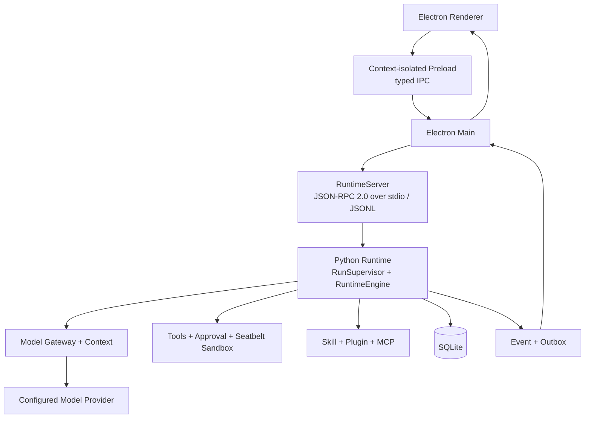

# Eidos

> Give ideas an executable form.

[English](README.md) · [简体中文](README.zh-CN.md)

Eidos is a macOS desktop Agent Runtime for software work. It brings projects, sessions, models, and local workspaces into one desktop app. An agent can read code, search, edit files, run commands, and work with Git changes. The Runtime manages tool execution, approvals, sandboxing, persistence, and recovery.

Eidos stores Runtime data locally. Requests go to the Provider configured by the user when a remote model service is used.

## Interface preview


*Captured from an isolated test page running the Eidos Renderer with sample session data.*

## Core features

- **Projects and sessions**: Work with multiple workspaces and sessions. Git projects can run locally or in a managed worktree.
- **Code workflows**: Browse files, search text, review diffs, and run common Git operations. Checkpoints support fork and rewind.
- **Durable Agent Runtime**: The Runtime stores Runs, Steps, tool results, and events. It handles cancellation, approval waits, and restart recovery.
- **Models and context**: Configure model Providers. The Runtime freezes model and extension snapshots for each Run, and provides context usage and compaction.
- **Tool permissions**: Agents can use file tools and a controlled Shell. Approval and macOS Seatbelt restrict high-risk operations.
- **Extensions and automation**: The Runtime supports Skills, Plugins, stdio MCP, local scheduled tasks, and a DingTalk message channel.

See [current capabilities](docs/current/capabilities.md) and [current limitations](docs/current/limitations.md) for details.

## Architecture



The Renderer calls Electron Main through typed IPC exposed by a context-isolated Preload. Main connects to the Python Runtime through JSON-RPC 2.0, JSONL, and stdio. The Runtime owns the Agent Loop, permission decisions, tool execution, and recovery semantics. SQLite is the single source of truth for business state.

Read [current architecture](docs/current/architecture.md) and the [architecture overview](docs/architecture/overview.html) for more details.

## Install and run

Eidos currently supports macOS arm64. Development requires Node.js 22.12 or later, pnpm 11, Python 3.11 or 3.12, and [uv](https://docs.astral.sh/uv/).

Run these commands from the repository root:

```bash
pnpm install
uv sync --locked
pnpm start
```

After launch, configure a model Provider and API key in Settings to run an agent.

Maintainers can run `pnpm package:mac` on Apple Silicon macOS to create a local unsigned DMG. A signed release requires Apple Developer and notarization credentials. See [DEVELOPMENT.md](DEVELOPMENT.md) for full installation, development, verification, and packaging instructions.

## Development roadmap

This roadmap describes current direction. It does not promise delivery dates.

1. Establish evaluation baselines with real software tasks and improve long-context handling and interruption recovery.
2. Complete Agent Shell PTY support, user Hooks, streaming tool scheduling, subagent isolation and result delivery, and browser-based visual verification.
3. Complete the macOS arm64 signing, notarization, and release workflow. Improve checks for upgrades, backup and restore, and diagnostics.
4. After the core workflow is stable, evaluate remote MCP and OAuth, a Plugin Marketplace, a CLI, and support for other platforms.

## Documentation

- [Current architecture](docs/current/architecture.md)
- [Current capabilities](docs/current/capabilities.md)
- [Current limitations](docs/current/limitations.md)
- [Development and verification](DEVELOPMENT.md)
- [Documentation index](docs/README.md)

## License

Eidos project code is licensed under the [Apache License 2.0](LICENSE). It allows use, modification, redistribution, and commercial use. Redistributors must include a copy of the license and retain applicable copyright, patent, trademark, and attribution notices. Modified files must carry notices stating that they were changed. The license includes a limited patent grant, but it does not grant trademark rights or provide warranties. Third-party dependencies and assets remain under their own licenses.
