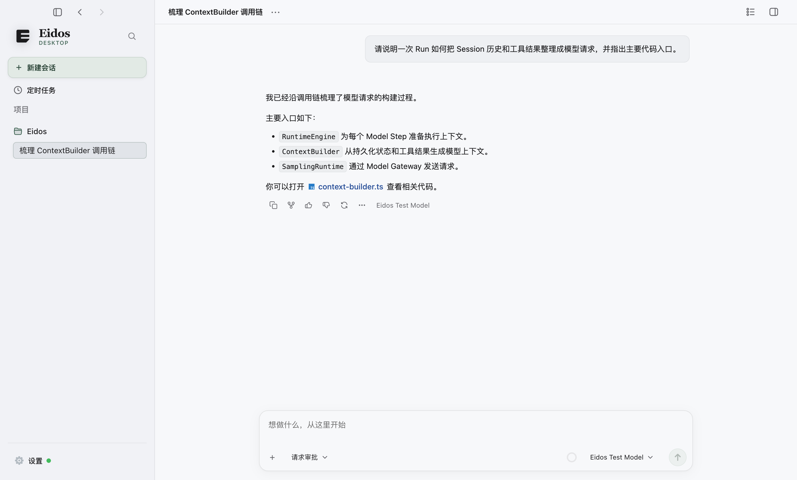
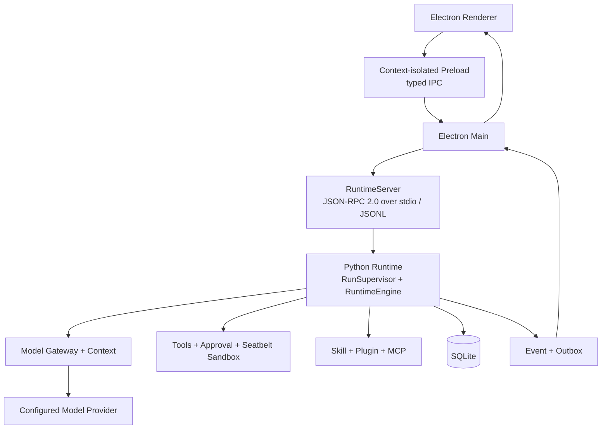

# Eidos

> 让想法拥有可执行的形态。

[简体中文](README.zh-CN.md) · [English](README.md)

Eidos 是面向软件工作的 macOS 桌面 Agent Runtime。它把项目、会话、模型和本地工作区放在一个桌面环境中。Agent 可以读取代码、搜索、编辑文件、运行命令和处理 Git 变更。Runtime 负责工具执行、审批、沙盒、持久化和恢复。

Eidos 将 Runtime 数据保存在本机。使用远程模型服务时，请求会发送到用户配置的 Provider。

## 界面预览



*截图来自运行 Eidos Renderer 的隔离测试页面，使用示例会话数据。*

## 核心功能

- **项目与会话**：管理多个 Workspace 和 Session。Git 项目可以使用 Local 或独立 Worktree 执行。
- **代码工作流**：浏览文件、搜索文本、查看 Diff，并执行常见 Git 操作。Checkpoint 支持 Fork 和 Rewind。
- **持久化 Agent Runtime**：Runtime 保存 Run、Step、工具结果和事件。Runtime 可以处理取消、审批等待和重启恢复。
- **模型与上下文**：配置模型 Provider。Runtime 固定每个 Run 的模型和扩展快照，并提供上下文用量与压缩。
- **工具权限**：Agent 可以调用文件工具和受控 Shell。Runtime 使用 Approval 与 macOS Seatbelt 限制高风险操作。
- **扩展与自动化**：Runtime 支持 Skill、Plugin、stdio MCP、本地定时任务和钉钉消息渠道。

详细能力和当前限制见[当前能力](docs/current-capabilities.md)与[当前限制](docs/current-limitations.md)。

## 架构



Renderer 通过 context-isolated Preload 的 typed IPC 调用 Electron Main。Main 使用 JSON-RPC 2.0、JSONL 和 stdio 连接 Python Runtime。Runtime 拥有 Agent Loop、权限决策、工具执行和恢复语义。SQLite 是业务状态的唯一事实来源。

更多架构细节见[当前架构](docs/current-architecture.md)和[架构图](docs/architecture-overview.html)。

## 安装与运行

Eidos 当前支持 macOS arm64。开发机需要 Node.js 22.12 或更高版本、pnpm 11、Python 3.11 或 3.12，以及 [uv](https://docs.astral.sh/uv/)。

在仓库根目录运行：

```bash
pnpm install
uv sync --locked
pnpm start
```

应用启动后，用户需要在设置中配置可用的模型 Provider 和 API Key，才能运行 Agent。

维护者可以在 Apple Silicon macOS 上使用 `pnpm package:mac` 生成本地未签名 DMG。签名发布还需要 Apple Developer 和公证凭据。完整安装、开发、验证和打包说明见 [DEVELOPMENT.md](DEVELOPMENT.md)。

## 开发路线

路线描述当前方向，不代表交付日期承诺。

1. 用真实软件任务建立评测基线，并继续提升长上下文处理与中断恢复的可靠性。
2. 完善 Agent Shell PTY、用户 Hooks、流式工具调度、子 Agent 隔离和结果交付，以及浏览器视觉验证。
3. 打通 macOS arm64 的签名、公证和发布流程，并完善升级、备份恢复和诊断流程的验收。
4. 核心工作流稳定后，再评估远程 MCP 与 OAuth、Plugin Marketplace、CLI 和其他平台支持。

## 文档

- [当前架构](docs/current-architecture.md)
- [当前能力](docs/current-capabilities.md)
- [当前限制](docs/current-limitations.md)
- [本地开发与验证](DEVELOPMENT.md)
- [文档导航](docs/README.md)

## 许可证

Eidos 项目代码采用 [Apache License 2.0](LICENSE)。该许可证允许使用、修改、再分发和商业使用。再分发时需要附上许可证副本，并保留适用的版权、专利、商标和署名声明。修改过的文件需要标明改动。该许可证包含有限的专利授权，但不授予商标使用权，也不提供担保。第三方依赖和资源仍遵循各自的许可证。
