# 定时任务、渠道与持续任务入口

定时任务和渠道负责把已保存的触发条件或远端消息接入普通 Run。它们复用同一个模型、权限、工具、取消和恢复系统。本文的核对基线见[组成总览](harness-overview.md)。

## 统一接入结构

图源：[Mermaid](diagrams/20-entrypoints.mmd)。图中的来源记录和授权记录分别保存。远端消息不能充当本机人工确认。

| 入口 | 持久事实 | 执行目标 | 输出 |
| --- | --- | --- | --- |
| 本地定时任务 | 计划、时间规则、触发认领、执行来源与计划快照 | 任务复用 Session，或按保存配置创建新 Session / Worktree。 | 普通 Run 回答与计划执行历史 |
| 渠道消息 | 连接配置、远端身份、入站去重、会话映射与 Run 来源 | 系统把合法消息映射到本地 Session。 | 持久回复、投递结果与渠道消息 |

## 定时任务怎样触发

AutomationScheduler 是未来触发时间的内存缓存。SQLite 决定计划状态、原子认领和 Run 接纳。调度由已有 AnyIO Kernel 与 Supervisor 管理，系统没有额外的云执行器或常驻守护进程。

调度器在计划到期时复核计划版本和目标，并保存本次快照。普通 Run 固定模型、思考设置和权限。已有 Session 复用其历史与压缩机制；新 Session 使用自足任务正文，不复制创建对话的全部附件。

Eidos 完全退出或电脑休眠时，任务不执行。系统只计算未来时间，不补跑漏过的触发。计划暂停、删除、忙碌目标、重启和时间跳变由持久状态与重新计算处理。具体时间与占用规则见[当前定时任务](../current/features/automations.md)。

## 权限怎样固定

模型创建的计划只允许 `manual` 和 `auto_review`。Desktop 允许用户在 danger 确认后保存 `full_access` 计划，并把确认版本用于每次未来 Run 的接纳。模型不能通过修改任务文字或时间把计划升级为完全访问，也不能自由修改已经完全访问的计划内容。

未来 Run 不继承其他 Run 的临时 Grant。定时输入会标注为预先保存的任务，不能解释为用户当下的新授权。自动 Run 也不能把这些输入作为自动记忆证据。

## 渠道怎样收发

ChannelService 管理钉钉、飞书和企业微信适配器的连接与工作循环。适配器先验证连接、消息和身份，ChannelApplication 再持久登记入站记录并去重，按配置映射 Session 并接纳 Run。

Run 完成后，系统读取持久结果生成回复，并保存待发送与投递状态。配置变化、网络断开、重启和取消沿连接版本与投递记录处理。连接状态缓存用于展示，不能代替数据库中的业务来源。

外部回复发生结果不确定时，系统必须保留真实状态，并按具体适配器的幂等与恢复规则处理。官方文档不能对所有渠道统一承诺 exactly-once。

渠道用户是远端输入来源。该身份不等于坐在 Desktop 前的本机用户，也不能批准高危操作。凭据保存在受保护文件，公开配置与模型上下文使用引用或经过过滤的字段。

## 当前限制与源码入口

本地计划不提供跨设备执行、离线补跑或云端 SLA。渠道的真实账号、组织策略、网络与投递限制仍需要分别验证。模拟 SDK、HTTP 或隔离 UI 用例只能证明其覆盖的机制。

| 机制 | 生产源码 | 相关测试 |
| --- | --- | --- |
| 调度与接纳 | [automation_scheduler.py](../../runtime/eidos_runtime/runtime/automation_scheduler.py)、[automations.py](../../runtime/eidos_runtime/application/automations.py)、[计划 Repository](../../runtime/eidos_runtime/persistence/automations.py) | [定时任务](../../runtime/tests/test_automations.py)、[Main 契约](../../desktop/main/runtime-client-automations.test.ts) |
| 渠道连接与消息 | [channel_service.py](../../runtime/eidos_runtime/runtime/channel_service.py)、[channels.py](../../runtime/eidos_runtime/application/channels.py)、[渠道 Repository](../../runtime/eidos_runtime/persistence/channels.py) | [渠道](../../runtime/tests/test_channels.py)、[适配器](../../runtime/tests/test_channel_adapters.py)、[Main 契约](../../desktop/main/runtime-client-channels.test.ts) |

返回[组成总览](harness-overview.md)。
