# Plan、人机协作与子 Agent

Eidos 在现有 Run 之上持久保存计划、用户输入请求和子任务依赖。子 Agent 仍是普通 Runtime 执行链中的 Child Run。本文的核对基线见[组成总览](harness-overview.md)。

## 协作结构

图源：[Mermaid](diagrams/19-collaboration.mmd)。Plan 框表示任务组织关系。Runtime 不要求每次委派前都调用计划工具。

| 对象 | 它表达什么 | 状态怎样继续 |
| --- | --- | --- |
| Plan | 模型当前的步骤、进度与任务结构 | 系统保存更新，但计划文字不能证明操作已完成。 |
| 用户输入请求 | 当前 Run 需要的用户选择或信息 | 回答到达后，原 Run 沿持久请求继续。 |
| Agent Delegation | 父 Run、Child Session、角色、模型和完成依赖 | Supervisor 调度 Child Run。 |
| Agent Message | 双方明确发送的消息与交付状态 | 后续请求按持久记录接收未读消息。 |
| Wait Record | 父任务正在等待的子任务集合与期限 | 依赖完成或期限到达后，父任务恢复检查。 |

## 角色、输入与权限

内置角色包括 `default`、`explorer` 和 `worker`。角色描述任务侧重，`explorer` 不是只读权限模式。自定义 Agent 从固定目录与定义快照解析说明和模型。

父模型通过 `spawn_agent` 提供自足任务。Child 接收任务正文，不复制父对话的全部历史。Child 继承 Workspace、固定权限和普通工具，也可以只读访问 Root 范围的记忆。Child 不能再次委派、直接请求用户输入或扩大权限；需要的审批由父链处理。

当前内置委派共享父 Workspace，系统不会为每个 Child 自动创建独立 Worktree。用户任务中的文件所有权和提交方式仍需要明确。多个 Child 写同一文件时，最终冲突检查仍由工具的版本核验承担。

## 调度与持久等待

每个父 Run 最多保存 16 个 Agent 委派，同时执行的 Child Run 最多 8 个。调度器按父 Run 统计 `running` / `finalizing` 子任务。待审批或待输入任务不会占用其他父任务的名额。这个限额也不是 Runtime 的全局 Run 配额。

`required_for_completion` 标记结果是否为父任务完成所需。普通等待可以释放 Worker，并由持久记录唤醒。如果父 Worker 还拥有活动 Shell，等待保留该所有者，避免释放资源时误杀进程；等待仍不持有数据库事务或共享执行许可。

父任务完成时，Runtime 处理必要依赖，并取消可选子任务、等待资源清理。父任务取消会向 Child 传播。未知副作用只作为结果事实保留，不能成为阻止父任务正常完成的额外核验门。

## 消息与结果

当前消息与最终结果使用持久资料和分页回读。消息正文最多 64 KiB UTF-8，模型视图保留有界近期消息；更长历史可按引用读取。`read_agent_result` 的单页最多 64 KiB，游标按字节边界核对。模型不应把摘要截断等同于子任务没有更多结果。

`send_message` 向当前委派发送消息，`followup_task` 根据目标状态追加消息或启动后续执行。运行中的 Child 不会因为 follow-up 被无条件重置。`wait_agents`、`list_agents` 和停止操作使用持久 Agent 身份。

## Plan 模式与完成证据

Plan 模式表达用户当前要求分析和制定计划。模式相关工具与权限约束继续由 Runtime 校验。计划保存失败需要返回真实错误，模型不能宣称已经更新。

父模型需要根据 Child 的工具与产物证据判断目标是否完成。Child 的“测试通过”自述不能自动升级为真实验证。系统目前没有自动解决共享 Workspace 冲突、自动合并分支或自动验收所有产物的闭环。

## 源码与测试入口

| 机制 | 生产源码 | 相关测试 |
| --- | --- | --- |
| Plan 与用户输入 | [planning.py](../../runtime/eidos_runtime/application/planning.py)、[Plan 工具](../../runtime/eidos_runtime/tools/planning.py)、[持久 Plan](../../runtime/eidos_runtime/persistence/planning.py) | [Plan](../../runtime/tests/test_planning.py) |
| 委派与角色 | [collaboration.py](../../runtime/eidos_runtime/application/collaboration.py)、[domain/collaboration.py](../../runtime/eidos_runtime/domain/collaboration.py)、[agent_catalog.py](../../runtime/eidos_runtime/application/agent_catalog.py) | [协作](../../runtime/tests/test_collaboration.py) |
| 调度、消息与分页 | [runs.py](../../runtime/eidos_runtime/db/repositories/runs.py)、[persistence/collaboration.py](../../runtime/eidos_runtime/persistence/collaboration.py)、[协作工具](../../runtime/eidos_runtime/tools/collaboration.py) | [协作](../../runtime/tests/test_collaboration.py)、[Desktop 投影](../../desktop/renderer/src/collaboration.test.ts) |

重启、取消、共享文件竞争和真实多任务交付仍需分别验收。返回[组成总览](harness-overview.md)。
