# 上下文构建与压缩算法

ContextBuilder 为每次请求构建有界输入。压缩器减少模型反复看到的历史正文，并保留来源、控制事实和回读路径。原始历史仍由 SQLite 与 Blob 保存。本文的核对基线见[组成总览](harness-overview.md)。

## 从持久事实到模型请求



图源：[Mermaid](diagrams/03-context-build.mmd)。ContextPlan 记录 Profile、规则、检索来源、预算、遗漏和请求身份。ContextSnapshot 在此基础上绑定 ModelAttempt，并固定实际消息、指令和工具定义。

Builder 会组合当前目标、历史 Item、已验证摘要、工具结果、输入引用、Repository Map 和检索证据。InstructionResolver 解析系统和项目指令。记忆只自动投影短索引，正文按需读取。Skill 和 Agent 的说明按各自的选择与激活规则进入上下文。

Builder 按响应组恢复 reasoning、工具声明和结果，避免拆散同一次响应所需的回放关系。已压缩来源从普通历史投影中排除。当前用户目标继续保留。工程校验 Hash 保存在内部记录，模型投影会清理这些字段。

## 输入引用与多模态资料

用户选中的文件、文本、图片和 Agent 定义先经过输入准备链保存引用快照。Run 接纳时会复核来源。Builder 使用这些已保存资料，不允许 Renderer 直接读取 Runtime 文件。历史引用和图片受本次字节预算控制，超限时会留下遗漏说明。

`view_image` 只向声明支持图像输入的模型开放。工具经过受控读取后捕获图片内容，并沿普通 ToolResult 提交边界保存。模型 Adapter 使用已保存字节生成多模态输入，不重新读取可能已经变化的源路径。图片估算成本继续进入 ContextBudget。

## 预算怎样计算

下面的符号直接对应 [budget.py](../../runtime/eidos_runtime/context/budget.py)：

```text
W = Run 固定的 context_window_tokens
O = 当前请求的最大输出 tokens
M = min(8192, max(1024, ceil(W × 0.02)))
U = W - O - M
E = 序列化请求正文估算 + 协议开销 + 媒体估算
协议开销 = 64 + 8 × 消息数 + 16 × 工具调用数 + 16 × 工具结果数
fits = projected_input_tokens <= U
```

系统使用随包的 `cl100k` 参考词表和 tiktoken 估算文本。该词表不是所有 Provider 的精确 Tokenizer。词表丢失或损坏时，系统使用 UTF-8 字节数作保守估算。图像等媒体也使用明确的估算值。

Provider 的实际 input usage 只描述已发送请求。设旧请求的实际输入为 `P0`，旧参考估算为 `E0`，新请求估算为 `E`。系统按 `delta = E - E0` 校准新投影：增长使用 `max(1, P0/E0)`，缩减使用 `P0/E0`，再把结果加到 `P0`。界面分项是按参考权重分配的估算，不能视为 Provider 的逐项测量。

## 系统先清理可回读投影

Builder 在正文过大时先尝试清除旧工具结果的投影正文。清除阈值是 `min(65536, max(1, U × 3 // 4))`，目标是该阈值的四分之三。系统保护最近完整响应组，并保留旧结果的回读引用。系统没有删除原始结果，也没有重新执行工具。

这一机制可以减少压缩请求的成本。它与 CompactSummary 的生成是两个步骤。相关工具的完整结果可以通过 `read_tool_output` 分页回读。

## 压缩触发与算法



图源：[Mermaid](diagrams/04-compaction.mmd)。系统在成功提交摘要后重新测量整个请求，测量包含指令、工具、保留历史与摘要。

| 入口 | 触发条件 | 系统怎样处理 |
| --- | --- | --- |
| 早期自动压缩 | 请求仍 `fits`，未取整的投影输入达到固定窗口 `W` 的 85%，且没有待审批 | 系统保护最近完整响应组。同一上下文状态只尝试一次早期压缩。 |
| 窗口压力 | 请求超出可用输入预算 | 系统按 `pre_turn` 或 `mid_turn` 选择可压缩来源，然后重建。 |
| 内部投影超限 | 候选历史超过内部边界 | 系统先压缩或采用容量恢复投影。 |
| 用户手动压缩 | 存在持久压缩请求，且没有待审批 | 系统使用请求 ID 记录本次压缩。 |

早期压缩的常量包含 `keep_recent_items=16`。当前 Engine 还传入 Token 预算 `min(16384, max(1024, U // 8))`，所以实际保护集合按最近响应组和 Token 预算选择，并非严格保留 16 个 Item。最新完整响应组即使超过目标预算也受到保护。早期压缩只选已结束的资料，并保留用户消息和 Skill 读取。

压缩器按以下顺序运行：

1. 压缩器读取 Run 活跃状态、原始 ContextFacts、上一份摘要和并发 guard。
2. 压缩器排除当前目标、已覆盖资料和保护集合。`pre_turn` 排除当前 Run 的资料；`mid_turn` 可以处理当前 Run 已有的可用资料。
3. 压缩器生成规则摘要，保存目标、约束、工具成功与失败、Workspace 变化、待办、审批和未知副作用。Assistant 的自述会带未验证标记。
4. 压缩器按预算拟合规则摘要。摘要 Token 目标是 `min(4096, max(512, (W-O) // 12))`。序列化总上限另为 24 KiB。
5. 模型可用且支持工具输出时，系统调用一次 `submit_context_summary`。该调用只返回结构化 notes，不执行业务工具。请求有 60 秒截止时间，输出最多 8 条 notes，每条需要 1 至 4 个精确引句。
6. Runtime 核对引句、Item 身份和资料类型，再合并 notes。模型失败、超时或格式错误时，系统保留规则摘要。
7. 独立验证器再次核对来源覆盖、旧约束、Workspace 变化、审批、未知副作用、连续证据和并发状态。Repository 在事务边界保存摘要与来源，并记录事件。
8. Builder 重建请求并重新测量。早期尝试失败时，只要原请求仍能放入真实预算，系统可以继续采样。关键资料超限或来源变化时，系统拒绝候选并保留旧摘要。

## 连续压缩怎样避免把摘要当证据



图源：[Mermaid](diagrams/05-continuity.mmd)。`CompactContinuityNote` 记录类型、来源类型、Item ID、原始引句和必要回读入口。系统在下一轮回到原始 Item 重新核对，旧摘要只提供组织上下文。

| Note 类型 | 验证器允许的证据含义 |
| --- | --- |
| `fact` | 用户资料或成功工具提供当时的观察；Assistant 自述不能成为确认事实。 |
| `decision` | 用户消息可以证明用户决定；其他来源会降为未验证。 |
| `verification` | 证据必须来自已完成、exit code 为 0、没有输出不完整标记的 Shell 真实输出。 |
| `proposal` / `next_action` | 模型可以解释后续建议，但资料仍需引用来源。 |
| `unverified` | 系统明确保留尚未核实的报告。 |

模型输入使用最多 8 KiB 的单条头尾预览，并给出原始结果回读路径。同一路径的不同内容版本保持不同证据。记忆工具正文不会复制进模型辅助摘要来源。

系统独立保留已经接受的连续证据。证据最多 128 条，独立投影最多 32 KiB，完整摘要还受 24 KiB 与 Token 预算约束；这些上限同时生效。拟合会缩减普通叙述，但不能靠丢弃旧约束、已接受证据或控制事实来通过预算。

## 一个说明用例

以下内容是机制示例，不是真实测试结果：用户先要求“只分析，不改代码”。工具随后读到 `config.py`。Shell 的真实结果包含 `3 passed`。后续摘要可以保留用户约束、当时文件观察和这次历史验证的引句。

下一次压缩时，系统重新读取这些 Item。文档里出现的 `3 passed` 示例不会成为执行验证。用户后来修改同一路径时，旧读取仍是历史证据；模型需要再次核对当前文件。预算不足时，系统保留原摘要，并让后续恢复机制处理压力。

## 当前限制与发布准备

压缩无法保证模型第一次就选中所有重要信息。头尾之外的内容仍需按引用回读。系统没有任意历史片段的语义检索、事实自动失效或全窗口压后质量保证。连续证据保留到上限后，系统不会自动推断哪些事实已经过时。

源码中的版本校验、模拟长序列和失败用例可以约束机制。真实 Provider 的压缩质量、长期任务目标保持和成本变化仍需要单独评测。

## 源码与测试入口

| 机制 | 生产源码 | 相关测试 |
| --- | --- | --- |
| 请求投影与预算 | [builder.py](../../runtime/eidos_runtime/context/builder.py)、[budget.py](../../runtime/eidos_runtime/context/budget.py)、[tokens.py](../../runtime/eidos_runtime/context/tokens.py)、[plan.py](../../runtime/eidos_runtime/context/plan.py) | [ContextPlan](../../runtime/tests/test_context_plan.py)、[Usage](../../runtime/tests/test_context_usage_protocol.py) |
| 输入引用与图片 | [input_context.py](../../runtime/eidos_runtime/application/input_context.py)、[view_image.py](../../runtime/eidos_runtime/tools/view_image.py)、[tool_content.py](../../runtime/eidos_runtime/persistence/tool_content.py) | [输入快照](../../runtime/tests/test_input_context.py) |
| 旧工具结果清理 | [tool_history.py](../../runtime/eidos_runtime/context/tool_history.py)、[working_set.py](../../runtime/eidos_runtime/context/working_set.py) | [历史清理](../../runtime/tests/test_context_history_pruning.py) |
| 压缩入口与规则 | [engine.py](../../runtime/eidos_runtime/runtime/engine.py)、[policy.py](../../runtime/eidos_runtime/context/policy.py)、[compactor.py](../../runtime/eidos_runtime/context/compactor.py) | [触发策略](../../runtime/tests/test_context_compaction_policy.py) |
| 模型辅助与连续证据 | [model_summary.py](../../runtime/eidos_runtime/context/model_summary.py)、[summary_evidence.py](../../runtime/eidos_runtime/context/summary_evidence.py)、[facts.py](../../runtime/eidos_runtime/context/facts.py) | [模型摘要](../../runtime/tests/test_context_model_compaction.py)、[连续压缩](../../runtime/tests/test_context_compaction_continuity.py) |
| 独立验证与事务 | [verified_compaction.py](../../runtime/eidos_runtime/context/verified_compaction.py)、[持久化 Repository](../../runtime/eidos_runtime/persistence/verified_compaction.py) | [摘要验证](../../runtime/tests/test_verified_compaction.py)、[摘要持久化](../../runtime/tests/test_verified_compaction_persistence.py) |

返回[组成总览](harness-overview.md)。
