# Skill、Plugin、MCP 与 Hook

扩展系统把说明、工具、账号连接和生命周期处理分开。扩展先进入受控安装与固定快照，再通过原有 Runtime 链运行。本文的核对基线见[组成总览](harness-overview.md)。

## 扩展接入结构

图源：[Mermaid](diagrams/17-extensions.mmd)。Plugin 包、账号连接和单次工具调用各有独立授权；安装成功不会自动获得远端账号或路径权限。

| 组成 | 它提供什么 | 当前执行方式 |
| --- | --- | --- |
| Skill | 名称、说明、参考资料、脚本与资产 | 模型按需读取，再调用现有工具。 |
| Plugin | 一组有版本的 Skill、Hook 和 MCP 声明 | Runtime 校验包并发布私有版本目录。 |
| MCP | 远端或独立进程提供的工具目录与调用 | 官方 MCP SDK 负责 transport/session，Eidos 负责授权、契约与结果。 |
| Hook | 生命周期事件上的命令或 MCP 处理 | HookService 按事件和固定绑定消费结果。 |

## Skill 的分层加载

Discovery 读取 bundled system、用户和 Plugin Skill。Catalog 保存名称、描述、qualified ID、来源、版本与内容身份。Turn 开始时，Runtime 固定 Catalog 和已选择的 Skill。完整正文只在选中或激活后读取。

`SKILL.md` 提供主说明。`skill_read_resource` 按需读取相对 `references/`、`scripts/` 或 `assets/`。资源路径必须受限于已验证的 Skill Root。文本读取有边界；二进制资产不能作为 UTF-8 正文直接注入上下文。

Skill 脚本通过既有 `run_shell` 运行。Runtime 可以识别受信任 Skill 脚本并激活对应只读 Root。`agents/eidos.yaml` 可以声明受限的依赖 metadata，但声明不会自动安装软件或授予网络与写入权限。系统只为支持的依赖声明和已核对的脚本选择运行环境。

## Plugin 的版本与更新

PluginCatalog 校验 manifest、Skill metadata、文件路径、类型、数量、大小和内容身份。安装内容位于 `extensions/plugins/<pluginId>/<version>/`。用户插件不会动态 import 到 Runtime 主进程。

显式更新在事务中切换当前版本、停用插件并清除旧 Hook 信任与 MCP 授权。相同版本的不同内容会被拒绝；相同内容重复导入保持幂等。旧 Run 使用其固定版本和内容身份，活动引用保护旧目录。已有生命周期清理只在引用结束后回收退役内容。

## MCP 的调用与账号生命周期

当前 transport 包含本地 stdio 与远程 Streamable HTTP。手动 MCP 编辑器当前配置本地进程；远程地址由 Plugin 声明。两类 transport 都由共享 RuntimeAsyncKernel 管理连接，并进入同一 Tool Registry、Approval、Intent、timeout 与结果核验链。

McpConnections 管理独立账号版本。SQLite 保存连接状态和凭据引用，私有文件保存令牌。官方 SDK 负责 OAuth 发现、注册和 PKCE，Authlib 负责令牌请求与刷新。临时回环 HTTP 只接收 OAuth 授权码；本地控制面仍使用 stdio JSON-RPC。

每次远程请求前，系统核对配置、账号版本、启用状态和 consent。连接刷新锁只约束同一账号的短期刷新。工具执行不持有该锁。凭据不进入模型上下文或 Run 快照。远程服务器也不会因为建立连接就获得本地文件权限。

Server 声明一个工具，只能证明它出现在目录中。Eidos 还需要接受其 Schema、权限、输出内容和大小，并完成真实调用。已审阅服务声明的 `readOnlyHint=true` 可以影响普通审批，但声明本身不能证明服务实际没有副作用。

## Hook 的信任与生命周期

图源：[Mermaid](diagrams/18-hooks.mmd)。用户可配置 Hook 与内部 LoopLifecycle 观察器是两条不同链路。

HookService 校验个人、项目和 Plugin 的绑定及内容信任，并按事件匹配。当前事件覆盖 Session、用户输入、工具前后、权限请求、压缩前后、子任务和 Stop 等阶段。完整事件及同步/后台差异见[当前 Hooks](../current/features/hooks.md#已接入的事件)。

command Handler 复用原 Shell 沙盒、权限和执行链。MCP Handler 只调用当前 Run 已连接的服务器。Hook 通过有界 JSON 输入输出提供事件允许的上下文、反馈或决定。Runtime 按具体事件解释字段，Hook 输出不能修改任意 Runtime 状态。

普通 PermissionRequest allow 会保留 Hook 来源和已完成调用证据。高危请求仍需人工确认。HookLifecycle 由 Supervisor 管理后台命令，每 Session 最多同时运行 8 个后台 Hook。后台结果保存接收记录，不创建新 Run，也不改变原 Run 的完成判定。崩溃留下的调用会标为 unknown，系统不重放。

## 当前边界与源码入口

当前系统没有 Plugin 市场、MCP Apps 界面或任意平台插件的完整兼容承诺。GitHub 已有受管包与 PAT 路径；浏览器 Device Flow 仍受发行方 Client ID 和真实服务配置影响。Figma 等服务还需要各自的准入与真实账号验收。详细边界见[当前插件](../current/features/plugins.md)。

| 机制 | 生产源码 | 相关测试 |
| --- | --- | --- |
| 包与版本 | [plugin_package.py](../../runtime/eidos_runtime/extensions/plugin_package.py)、[plugins.py](../../runtime/eidos_runtime/extensions/plugins.py) | [Plugin 协议](../../runtime/tests/test_plugin_protocol.py) |
| Skill 加载与权限 | [skills.py](../../runtime/eidos_runtime/extensions/skills.py)、[skill_access.py](../../runtime/eidos_runtime/extensions/skill_access.py)、[run_resources.py](../../runtime/eidos_runtime/runtime/run_resources.py) | [Skill](../../runtime/tests/test_skills.py)、[访问](../../runtime/tests/test_skill_access.py)、[资源分页](../../runtime/tests/test_skill_pagination.py) |
| MCP 与连接 | [mcp.py](../../runtime/eidos_runtime/extensions/mcp.py)、[mcp_connections.py](../../runtime/eidos_runtime/application/mcp_connections.py) | [MCP](../../runtime/tests/test_mcp.py)、[远程](../../runtime/tests/test_remote_mcp.py)、[认证](../../runtime/tests/test_mcp_auth.py) |
| Hook | [hooks.py](../../runtime/eidos_runtime/runtime/hooks.py)、[hook_lifecycle.py](../../runtime/eidos_runtime/runtime/hook_lifecycle.py)、[hook_sources.py](../../runtime/eidos_runtime/extensions/hook_sources.py) | [协议](../../runtime/tests/test_hook_protocol.py)、[后台](../../runtime/tests/test_hook_background.py)、[生命周期](../../runtime/tests/test_hook_lifecycle.py) |

返回[组成总览](harness-overview.md)。
