# Eidos Harness 组成与阅读地图

本文把 Harness 定义为围绕模型组织任务、资料、工具、权限、状态和恢复的执行系统。模型负责提出下一步，Eidos 负责执行边界和业务事实。

本文与各专题以 **2026-10-25、源码基线 `58ba5ea9`** 为核对范围。本文中的“当前实现”来自源码；测试链接说明相关行为由哪些用例约束，不表示本次运行过这些测试。本文中的“发布前待验证”是后续文档和验收工作。

读者可以先看[离线架构图集](harness-atlas.html)，再按下表阅读机制。已有[进程架构图](overview.html)继续说明 Renderer、Main 与 Runtime 的边界。

## 组成总览



图源：[Mermaid](diagrams/01-harness.mmd)。实线表示主要调用或资料依赖；虚线表示约束、诊断或辅助关系。该图按职责分组，图中的框不都对应独立进程或目录。具体执行顺序见运行循环和工具专题。

## 十二个组成部分

| 组成部分 | 它解决的问题 | 当前实现与事实入口 | 专题 |
| --- | --- | --- | --- |
| 任务循环 | 系统怎样接纳任务、推进、等待和完成？ | Supervisor、Engine、Step、ModelAttempt | [运行循环](runtime-loop.md) |
| 上下文管理 | 模型本次看见什么？资料太多时怎样继续？ | ContextBuilder、Budget、Plan、Snapshot、Compactor | [构建与压缩算法](context-compaction.md) |
| 长期记忆 | 哪些资料能跨任务使用？用户怎样更正与遗忘？ | 短索引、主题笔记、版本、来源与撤销 | [记忆架构](memory.md) |
| 模型接入 | 多提供商怎样共享一条执行链？ | 配置、Profile、Lease、两类协议 Adapter、重试 | [Model Gateway](model-gateway.md) |
| 工具执行 | 模型建议怎样成为可核验操作？ | Tool Registry、Controller、Intent、Shell 与结果投影 | [工具运行](tool-runtime.md) |
| 权限隔离 | 什么操作可以直接执行？什么操作需要用户决定？ | Run 模式、Grant、人工审批、Seatbelt、文件 Helper | [权限与沙盒](permissions-sandbox.md) |
| 持久化恢复 | 进程重启后，系统能确认和恢复什么？ | SQLite 事务、Outbox、Recovery、资源关闭 | [持久化与恢复](persistence-recovery.md) |
| 工作空间与检索 | 系统怎样理解代码并管理修改？ | Workspace、Inventory、AST、FTS5、Worktree、Checkpoint | [Workspace 与检索](workspace-retrieval.md) |
| 扩展系统 | 外部能力怎样进入固定且可撤销的边界？ | Skill、Plugin、MCP、账号连接与 Hook | [扩展与 Hook](extensions-hooks.md) |
| 计划与协作 | 多个子任务怎样保留依赖和结果？ | Plan、委派、子 Run、持久消息与等待 | [Plan 与子 Agent](collaboration-planning.md) |
| 持续任务入口 | 定时和渠道任务怎样复用同一个 Runtime？ | 触发认领、入站去重、Run 来源与回复记录 | [定时任务与渠道](automation-channels.md) |
| 诊断与交付 | 维护者怎样证明系统正确、可用和可发布？ | 本地事实、日志、可选 Trace、测试与发布流程 | [诊断、评测与交付](observability-delivery.md) |

## 一次任务贯穿哪些部分

用户或已保存的触发条件先进入 Application。SQLite 保存 Run 和来源。Supervisor 按同 Session FIFO 启动 Worker。Engine 解析规则，固定模型和扩展，构建本次请求。

ContextBuilder 从持久历史、检索证据、记忆短索引和工具定义构建请求。Gateway 选择协议适配器。SamplingRuntime 保存每次 Attempt。Runtime 在响应完整且工具契约有效后，才执行工具。

工具先确定权限，再提交 Intent、执行和核验。事务同时保存结果、Event 和 Outbox。后续 Step 从这些事实重新构建上下文。用户的审批、输入或子任务结果可以使等待中的任务继续。取消、关闭和重启也依据这些记录处理。

## 五类资料各有不同用途

| 资料 | 系统怎样产生它 | 系统怎样使用它 | 它的边界 |
| --- | --- | --- | --- |
| 原始执行历史 | 用户输入、模型响应、ToolResult 与事件 | SQLite 与 Blob 保存可追溯事实 | 历史结果只能证明当时发生的情况。 |
| ContextSnapshot | 系统为某次模型请求固定输入 | 系统复查请求、重试与来源 | 快照受记忆撤销和有效权限约束。 |
| CompactSummary | 压缩器从原始事实提取有界资料 | 后续请求减少重复历史正文 | 摘要可能遗漏信息，原始记录继续保留。 |
| 长期记忆 | 当前 Run 或用户编辑主题笔记 | 新任务获得短索引并按需读取 | 记忆不能授予权限，也不能证明当前文件状态。 |
| 检索索引与缓存 | 系统扫描和解析 Workspace | 系统加快代码召回和排序 | 系统仍需核验真实文件身份与版本。 |

## 事实与权限边界

SQLite 保存业务状态、当前版本指针、审批和来源。正文文件、Blob、`models.json` 与扩展凭据文件承担各自的存储职责。`models.json` 是模型配置来源；SQLite 保存 Run 已固定的模型快照。私有正文文件存在，不代表它已经成为有效记忆。

Renderer 通过 context-isolated preload 和 typed IPC 访问 Main。Main 通过 stdio JSON-RPC 访问 Runtime。模型客户端、MCP transport、后台服务和观察器都不能建立另一套 Run 状态。

同 Session 的 Run 按 FIFO 执行。不同 Session 可以并行。每个父 Run 最多同时执行 8 个子 Run。系统没有跨 Session 的普通 Run 总量配额，也没有跨 Run 的共享副作用锁。

## 官方文档准备边界

| 可直接整理的材料 | 发布前仍需补足的材料 |
| --- | --- |
| 本目录的职责图、时序图、算法、存储与权限边界 | 维护者需要在目标发布版本重新核对图与源码。 |
| 各专题的源码和测试链接 | 维护者需要记录该版本实际运行的定向测试与失败。 |
| 各专题已经列明的限制 | 真实 Provider、长期任务质量、桌面操作和干净机器验收仍需要独立证据。 |
| 可编辑 Mermaid 与可复用 SVG | 术语、用户教程、多语言、发布截图与网站导航仍需官方文档编辑。 |

这些组成部分提供架构阅读框架。组成数量不能证明 Harness 已达到某个成熟等级。

## 图源与维护

维护者编辑 `diagrams/*.mmd` 和 [图目录](diagrams/catalog.json)。[渲染脚本](render-diagrams.cjs)使用仓库已有 Electron 与 Mermaid，生成 SVG 和离线 HTML。脚本只处理文档文件，不读取用户数据，不请求网络，不增加生产依赖。

```bash
pnpm exec electron docs/architecture/render-diagrams.cjs
pnpm exec electron docs/architecture/render-diagrams.cjs --check
git diff --check
```

第一条命令重新生成图。第二条命令复渲染并检查生成物是否一致。维护者修改机制时还需要同步对应专题、[当前架构](../current/architecture.md)或 [current/](../current/README.md) 中的其他说明，并按行为选择测试。图渲染通过只证明图可以生成。

返回[专题目录](README.md)。
