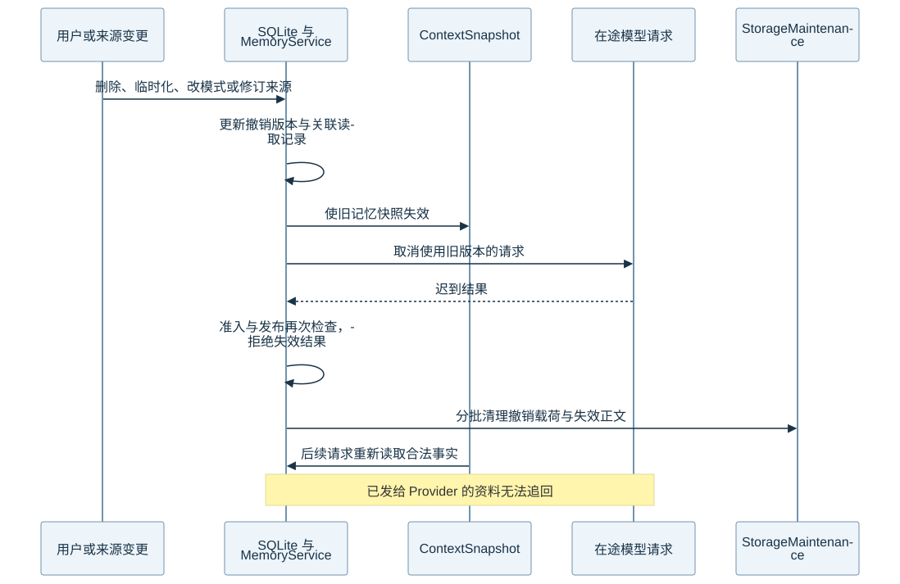

# 长期记忆架构

Eidos 当前使用“服务端生成的 `MEMORY.md` 短索引 + 主题 Markdown 笔记”。前台模型在当前 Run 内保存笔记，Run 等待保存结果。系统已经移除旧的后台模型整理、候选确认和历史回填路径。本文的核对基线见[组成总览](harness-overview.md)。

## 读取与发布结构

图源：[Mermaid](diagrams/06-memory.mmd)。用户和模型按相对笔记路径访问内容，服务端把路径映射到当前有效版本。

| 层 | 它保存什么 | 它负责什么 |
| --- | --- | --- |
| SQLite | Scope、模式、笔记、revision、证据、操作结果、抑制记录与撤销版本 | 数据库决定哪些笔记与版本有效。 |
| 私有版本文件 | `memory/scopes/<scope UUID>/revisions/<revision UUID>.md` 正文 | 文件提供不可变正文；孤立文件不能成为有效记忆。 |
| 生成索引 | 有效笔记的路径、摘要与继续读取提示 | `MEMORY.md` 提供短入口；模型不能编辑它。 |
| Context 投影 | 索引、来源引用、scope epoch 与 Root use epoch | 系统控制预算，并在后续使用前复查撤销。 |
| 工具与 Desktop | 搜索、读取、编辑、模式、临时对话与导出 | 两类入口复用 MemoryService 与版本检查。 |

## 范围与模式

服务端按项目身份决定全局和项目范围。Projectless 使用全局范围。项目 Worktree 共享所属项目记忆。子 Agent 沿 Root 的范围只读访问。

| 模式 | 自动索引与模型读取 | 模型自动保存 | 用户明确要求保存 |
| --- | --- | --- | --- |
| `off` | 系统关闭。 | 系统关闭。 | 系统仍可按当前 Run 的明确请求授权保存。 |
| `read` | 系统开启。 | 系统关闭。 | 系统允许明确保存和更正。 |
| `auto` | 系统开启。 | 系统在当前 Run 中执行。 | 系统允许明确保存和更正。 |

新范围默认 `auto`。临时对话关闭该会话的记忆使用和保存，并撤销原有记忆上下文。用户在设置页管理笔记的能力与模型模式分开处理。

定时任务和渠道输入不能成为自动记忆证据；它们的工具目录不开放记忆写入。记忆不授予权限，也不会修改 Run 的审批模式。

## 一次写入的算法

1. 模型根据真实来源组织主题笔记，并调用 `memory_edit`。`userRequested` 区分明确保存与自动保存；持久的未来行为要求也可以表达明确保存意图。
2. Runtime 在权限检查和 Durable Intent 之前捕获来源 Item 的具体版本。来源只接受合法用户消息或成功的普通工具结果。
3. 服务检查范围、模式、来源资格、目标 revision 和用户所有权。自动路径不能覆盖用户控制版本。删除必须有明确请求。
4. 工具沿现有权限链提交 Durable Intent。MemoryFiles 准备私有正文文件。
5. 发布事务重新检查捕获的来源、目标 `expectedRevision`、scope generation、撤销版本和取消状态。服务不能通过重新捕获已变化的来源接受旧请求。
6. 事务更新笔记、版本、来源、操作结果和 `memory.changed` Event/Outbox。Main 校验通知后，页面刷新。

相同 operation ID 和相同请求返回原结果。相同 ID 的不同请求会被拒绝。内容、标题、摘要、类型和所有权都相同时，服务不增加版本。更正现有笔记前，模型需要读取当前笔记并携带 revision。

Assistant 自述、记忆工具结果、失败或未完成工具、其他会话和已撤销来源不能成为自动证据。Runtime 保留这些确定性检查，但当前流程没有额外的模型事实审核；因此它不能保证模型写出的每一句话都在语义上正确。

## 读取、检索与预算

索引最多 200 行、约 24 KiB。ContextBuilder 的投影最多占可用输入预算的 5%，且最多 2,000 个估算 Token。系统优先放当前项目索引，并预留继续搜索和分页读取提示。

`memory_search` 使用 FTS5 unicode61、可用时的 trigram、短词 LIKE 和 RapidFuzz 重排。每个候选源最多读取 500 条。查询分页覆盖这个有界候选集，命中上限时返回 `searchLimited`。系统不把查询原文直接当作可执行 FTS 表达式。

`memory_read` 按路径和固定 revision 分页。单次最多返回 16,384 字符，单篇笔记最多 65,536 字符。系统没有旧的每 Run 三次读取配额。搜索不保证语义改写召回；模型仍可缩小查询或分页遍历文件列表。

## 撤销与遗忘

图源：[Mermaid](diagrams/07-memory-revocation.mmd)。模式变化、来源修订、会话删除、临时化、Run 重写和 Checkpoint 回退都可以使相关使用失效。

来源撤销按具体历史版本的所有权处理。用户后来编辑了笔记，也不能让旧自动版本的读取记录继续有效。当前独立的用户控制版本可以保留。

系统在快照保存、读取、重试、最终化和请求准入时检查撤销版本。服务取消使用旧资料的在途请求；忽略取消的迟到结果也不能发布。后续请求从合法事实重建。Context Usage 只读预算和 usage 元数据，不加载已撤销正文。

删除笔记会遗忘全部正文版本，并保留最小来源抑制记录，防止同一旧来源自动生成它。StorageMaintenance 由 Supervisor 管理，只清理撤销载荷、孤立文件与 Blob。它不调用模型。

## 存储与恢复限制

当前 schema 是 v41。v39→v40 按既定升级策略清空旧记忆并保留聊天等其他数据；v40→v41 修复历史自动版本的来源撤销。旧记忆接口和旧备份格式不兼容。升级细节和已有验证记录见[当前记忆](../current/features/memory.md)。

正文读取检查大小与 mtime。主动保留二者的篡改可能无法检出。遗忘不能追回已经发送给 Provider 的资料，也不能移除用户另存的导出、备份或自然语言复述。系统不承诺磁盘块安全擦除。

备份格式 `eidos-data-backup-v2` 保存一致的 SQLite、被引用正文、执行 Blob 和 Agent 定义。恢复导入新目录，接受当前 v40/v41 并完成升级，记忆模式设为 `read`。备份没有加密，也不包含 Workspace 和模型凭据。

## 源码与测试入口

| 机制 | 生产源码 | 相关测试 |
| --- | --- | --- |
| 严格契约与文件发布 | [contracts.py](../../runtime/eidos_runtime/memory/contracts.py)、[publication.py](../../runtime/eidos_runtime/memory/publication.py) | [笔记、CAS、分页与篡改](../../runtime/tests/test_memory.py) |
| 范围、证据与事务 | [service.py](../../runtime/eidos_runtime/memory/service.py)、[repository.py](../../runtime/eidos_runtime/memory/repository.py)、[工具](../../runtime/eidos_runtime/tools/memory.py) | [Run 集成与撤销](../../runtime/tests/test_memory_runtime.py) |
| 来源与迁移 | [lifecycle.py](../../runtime/eidos_runtime/memory/lifecycle.py)、[document_schema.py](../../runtime/eidos_runtime/memory/document_schema.py)、[revocation_migration.py](../../runtime/eidos_runtime/memory/revocation_migration.py) | [撤销升级](../../runtime/tests/test_memory_revocation_migration.py) |
| 清理与备份 | [maintenance.py](../../runtime/eidos_runtime/db/maintenance.py)、[backup.py](../../runtime/eidos_runtime/db/backup.py) | [备份恢复](../../runtime/tests/test_data_backup.py) |

真实 Provider 的长期记忆质量仍需独立验收。返回[组成总览](harness-overview.md)。
