# 多提供商 Model Gateway

Eidos 将模型配置、请求快照、生命周期和稳定错误留在 Runtime 中。当前 SDK 和适配器负责 Provider 请求机制。Eidos Loop 继续决定何时采样、执行工具和提交结果。本文的核对基线见[组成总览](harness-overview.md)。

## 配置、快照与协议路由

图源：[Mermaid](diagrams/08-model-routing.mmd)。图中的 Provider 名称表示当前配置与工厂支持的路径，不表示每个远端能力都经过真实请求验收。

| 层 | 它负责什么 | 关键边界 |
| --- | --- | --- |
| ModelConfigStore | 读取和保存受保护的 `models.json` | API Key 不进入公共模型列表、SQLite、Feed 和正常日志。 |
| Model Catalog / Profile | 解析本地配置、默认能力、思考选择和 Token 上限 | 用户配置优先；系统不按模型名称猜测未声明能力。 |
| Run Profile Snapshot | 固定本次 Run 的协议、预算、能力、思考与版本 | 设置变化不能静默替换活动 Run 的配置。 |
| Model Gateway / Lease | 创建和关闭本次使用的客户端，登记资源 | 共享 RuntimeAsyncKernel 管理异步 I/O。 |
| Provider Adapter | 转换请求、流、usage、工具声明与回放信息 | Adapter 返回统一结果，由 Runtime 校验和执行。 |

自定义模型有两个身份：`ModelConfig.id` 是本地稳定 ID，`modelId` / `remote_model_id` 是远端请求使用的 ID。`providerId` 是用户配置的提供商标识；它不创建另一套 Provider 实体或调度器。

## 当前实际支持的两条路径

| `wire_api` | 当前实现 | 工具与流式边界 |
| --- | --- | --- |
| `chat_completions` | Pydantic AI `OpenAIChatModel`，配合 DeepSeek、MoonshotAI 或 OpenAI-compatible Provider | 系统使用 Function Tool，并保留思考回放和完整工具参数。 |
| `openai_responses` | `OpenAIResponsesModelClient` 通过官方 OpenAI SDK 适配原生 Responses | 只有 `response.completed` 可以产生可执行响应。Custom Tool / Grammar 仅向显式声明两项能力的 Profile 开放。 |

内置 Catalog 当前覆盖 DeepSeek、MiniMax、Kimi 和 Volcengine，并使用 Chat Completions。自定义配置可以选择上述两类协议。当前实现不是任意 Provider SDK 的通用兼容承诺。

Responses 的 `failed`、`incomplete`、`error` 或没有完成事件的 EOF 都不能执行工具。系统会关闭旧流，并取消仍在等待的异步读取。当前 Responses 原生适配仍是 Eidos 的独立适配代码，文档不能把这条路径描述为已经全部交给 Pydantic AI。

能力解析遵循“用户配置 > Pydantic AI Profile > Eidos Preset > 保守默认”。设置页的 `model/discoverCustom` 只在用户主动操作时请求自定义地址的模型列表。该请求有时间、字节和条目边界；它不会生成回复，也不能证明工具或图像输入已经在线可用。系统没有后台主动 Capability Probe。

## 断流与重试

图源：[Mermaid](diagrams/09-model-retry.mmd)。以下参数来自当前普通 SamplingRuntime 与 Profile 默认值；历史 Run 保留其固定配置。

普通采样默认首次请求加最多 5 次重试。连接失败、超时、临时限流、可恢复 HTTP 错误和断流共享同一请求组。每次尝试有独立 ModelAttempt 与草稿；同组复用固定 ContextSnapshot。

首次临时失败开启默认 180 秒恢复窗口。请求和等待共同消耗窗口。Tenacity 生成 2、4、8、16、30 秒基础退避及随机等待；Pydantic AI 的 `wait_retry_after` 解析服务端最短等待。系统不会提前截短 Retry-After。等待不占 SQLite 事务或工具执行锁，并可被取消。

普通采样通过请求作用域关闭 Transport 内部重试，OpenAI SDK 也设置 `max_retries=0`。审批、压缩、标题和特殊收尾仍用各自策略。维护者需要区分这些入口，避免把不同层预算相乘。

结构化账户、余额、配额、认证或参数错误优先于宽泛的 429/5xx 分类。失败草稿以 failed/incomplete 保存，新 Attempt 新建 Assistant Item。系统不拼接新旧草稿，也不把失败草稿重新当作模型历史。

工具只在完整响应及批次校验后执行。后续模型重试不会重放已经完成的文件、Shell 或 MCP 操作。Runtime 重启只恢复允许的纯模型阶段，并保留已用次数、原期限和下次请求时间。耗尽预算不会重置为新的请求组。

## 用量、错误与凭据

ModelAttempt 保存输入与输出用量、响应元数据、有限重试诊断和稳定 Eidos 错误码。Provider 实际用量与上下文估算有不同含义，详见[上下文预算](context-compaction.md#预算怎样计算)。累计消费不能作为当前窗口占用。

API Key 沿 typed IPC 和 Runtime 请求进入受保护配置文件。公开 DTO 省略 Key。内部 reasoning 回放保存在受控 Blob 引用中，不作为普通 Feed Item 展示。系统需要这些协议资料时，会使用已保存回放，而非从 UI 重新推断。

## 当前限制与源码入口

当前普通采样存在明确重试次数与恢复期限。预算耗尽、不可重试错误和不可恢复中断仍会返回结束原因。该实现与 `AGENTS.md` 要求的持续可取消恢复之间还有待统一，本文不把目标规则当作已实现能力。

| 机制 | 生产源码 | 相关测试 |
| --- | --- | --- |
| 配置与 Profile | [config.py](../../runtime/eidos_runtime/model/config.py)、[gateway.py](../../runtime/eidos_runtime/model/gateway.py) | [配置存储](../../runtime/tests/test_model_config_store.py)、[自定义 Provider](../../runtime/tests/test_custom_model_providers.py) |
| SDK 工厂与两类适配 | [pydantic_factory.py](../../runtime/eidos_runtime/model/pydantic_factory.py)、[pydantic_ai_client.py](../../runtime/eidos_runtime/model/pydantic_ai_client.py)、[native_custom.py](../../runtime/eidos_runtime/model/native_custom.py) | [模型契约](../../runtime/tests/test_model_contracts.py)、[Chat 工厂](../../runtime/tests/models/test_model_chat_completions_factory.py) |
| 错误与重试 | [errors.py](../../runtime/eidos_runtime/model/errors.py)、[retry.py](../../runtime/eidos_runtime/model/retry.py)、[retry_transport.py](../../runtime/eidos_runtime/model/retry_transport.py)、[sampling.py](../../runtime/eidos_runtime/runtime/sampling.py) | [断流与恢复](../../runtime/tests/test_model_retry_recovery.py) |
| 请求投影与回放 | [context_projection.py](../../runtime/eidos_runtime/model/context_projection.py)、[replay.py](../../runtime/eidos_runtime/model/replay.py) | [思考回放](../../runtime/tests/test_model_reasoning_replay.py) |

真实端点的工具、图像、思考参数和计费需要逐项验收。返回[组成总览](harness-overview.md)。
