# 诊断、质量评测与发布证据

可观察性帮助维护者解释发生了什么。测试和评测分别约束机制与任务质量。发布验证再检查独立安装、升级和分发。本文给出当前入口与后续官方文档所需证据，不声明这些验证已经全部完成。

## 证据怎样连接

图源：[Mermaid](diagrams/21-quality.mmd)。图中从测试到发布的箭头表示验收阅读顺序，当前仓库不会自动用一项检查替代其余检查。核对基线见[组成总览](harness-overview.md)。

## 本地诊断与可选 Trace

SQLite、Event/Outbox、固定参数、ContextSnapshot 和原始工具结果提供诊断事实。维护者先按 Session、Run、Step、Attempt 和 ToolCall ID 关联资料，再检查日志与真实请求行为。

LoopLifecycle 提供采样前后、工具批次前后、压缩前和 Engine 离开等内部观察点。观察器失败只写日志，不能修改业务状态和权限。用户 Hook 的机制另见[扩展专题](extensions-hooks.md)。

当前源码已经包含 OpenTelemetry Provider 与 tracing 边界。默认 exporter 为 `none`；只有明确配置时才启用对应导出。Provider 初始化或导出失败需要被限制在诊断链中。文档不能因为目标规则曾把 OpenTelemetry 列为后续工作，就忽略已经存在的实现。

日志和诊断不应包含 API Key、Authorization、凭据、完整敏感文件或未脱敏环境。维护者提供公开示例时，需要使用合成数据或已经脱敏的真实记录。

## 五层证据各证明什么

| 证据层 | 它能证明什么 | 它还不能证明什么 |
| --- | --- | --- |
| 源码与静态检查 | 代码存在某条路径，类型与边界规则满足对应检查。 | 它不能证明真实服务已接受请求。 |
| 定向自动化测试 | 指定输入、故障与竞争用例符合预期。 | 它不能覆盖未运行的完整套件和所有原生差异。 |
| 真实 Provider / 原生 / Desktop | 实际端点、进程、沙盒和界面完成指定场景。 | 一次成功不能证明长期任务稳定和所有账户策略。 |
| 真实任务评测 | 固定任务集上的目标完成、失败恢复、上下文保持、成本和耗时。 | 小样本或合成回放不能外推全部任务质量。 |
| 发布验证 | Bundle、干净机器安装、升级、备份、签名、公证与 Gatekeeper。 | 本地 DMG 或 adhoc 签名不能替代正式分发证据。 |

## 官方文档的评测材料

后续评测应为每个任务保存：目标、起始仓库和数据、模型快照、权限模式、允许工具、完成条件、产物、检查命令、成本、时间和失败原因。维护者还需要说明模型、工具和完整 Harness 各自参与了什么。

长任务材料需要覆盖连续压缩、Provider 断流、用户取消、审批等待、Runtime 重启、未知副作用和多 Agent 文件竞争。最终判定需要检查产物，不能只读取 `Run succeeded` 或模型自述。

这些是发布准备建议。当前文档没有新增评测执行器，也没有新增通过分数。现有评估材料见[验证与评估目录](../evaluations/README.md)，维护者应保留每份材料原有日期和范围。

## 独立安装与发布链

Runtime Bundle 负责随包 Python、已锁定依赖、Node 运行依赖和必要 sidecar。用户不能因为某个工具存在，就被要求预装开发环境。Electron Main 负责启动、watchdog、协议、日志和关闭 Runtime。

本地打包与签名发布使用不同入口。维护者需要分别记录构建、Bundle 检查、原生 Sandbox、Electron smoke、安装升级、签名和公证。实际命令与环境见[开发参考](../development/README.md#构建打包与原生验证)。

## 本次补图的验证范围

本次工作只修改架构文档、图源、生成 SVG 和文档渲染工具。维护者应在交付记录中分别报告图渲染、生成物一致性、链接、离线页面和 Diff 检查。文档检查不能写成产品回归。

本次没有改动生产依赖、锁文件、协议或数据库，也没有运行 Full Suite、真实 Provider 质量评测、应用生命周期测试或安装包验证。现有依赖审计历史记录仍见[当前限制](../current/limitations.md)，本次没有重新审计，不能把历史结果称为当前通过。

## 源码与测试入口

| 机制 | 当前入口 | 相关验证 |
| --- | --- | --- |
| 诊断与观察 | [lifecycle.py](../../runtime/eidos_runtime/runtime/lifecycle.py)、[protocol_diagnostics.py](../../runtime/eidos_runtime/runtime/protocol_diagnostics.py) | [Runtime 架构约束](../../runtime/tests/test_runtime_architecture.py) |
| Trace | [provider.py](../../runtime/eidos_runtime/telemetry/provider.py)、[tracing.py](../../runtime/eidos_runtime/telemetry/tracing.py) | [Telemetry](../../runtime/tests/test_telemetry.py) |
| Main 日志与关闭 | [log-redaction.ts](../../desktop/main/log-redaction.ts)、[runtime-client.ts](../../desktop/main/runtime-client.ts) | [日志脱敏](../../desktop/main/log-redaction.test.ts)、[关闭](../../desktop/main/runtime-shutdown.test.ts) |
| 构建与分发 | [Runtime 构建](../../scripts/build-macos-runtime.sh)、[打包](../../scripts/package-macos.sh) | [Bundle smoke](../../scripts/bundled-runtime-smoke.mjs)、[Electron smoke](../../scripts/electron-smoke.mjs)、[原生 Seatbelt](../../scripts/test-seatbelt-native.py) |

返回[组成总览](harness-overview.md)。
