# 权限、审批与 Sandbox

Eidos 分开处理 Run 权限模式、操作授权和实际沙盒。模型提出路径或网络请求时，Runtime 仍需要根据固定模式和真实路径生成有效权限。本文的核对基线见[组成总览](harness-overview.md)。

## 决策结构

图源：[Mermaid](diagrams/12-permissions.mmd)。图中的高危人工审批来自 Desktop，自动审查模型不能代替这一步。

| 层 | 它表达什么 | 它不能替代什么 |
| --- | --- | --- |
| Run mode | `manual`、`auto_review` 或用户确认的 `full_access` | 项目文件、Skill 和模型参数不能切换模式。 |
| Base Permission | Workspace、默认网络与受保护路径规则 | 默认范围不能变成任意文件写入许可。 |
| Additional Permission / Run Grant | 当前请求或已保存授权增加的具体范围 | Grant 仍需要有效期、范围与当前身份检查。 |
| Permission Decision | Runtime 对当前操作给出 allow、ask 或 deny | 决定本身不证明文件或外部操作已完成。 |
| Effective Permission | Runtime 物化后的路径、网络和执行配置 | Runtime 仍需重新核验实际路径。 |
| Seatbelt / File Helper | 系统进程限制与受控文件提交 | Sandbox 不能替代 Durable Intent 和结果核验。 |

## 三种模式

`manual` 使用已有授权直接执行允许操作，并为需要扩权的操作请求用户决定。`auto_review` 可以让审查模型处理普通审批；高危请求仍要求用户确认。两种模式默认保留 Seatbelt 和路径保护。

`full_access` 只能来自 Desktop 用户确认。普通 Run 使用本次确认；定时任务和渠道 Run 可以继承用户在 Desktop 确认并保存的配置。该模式关闭 Seatbelt，使用当前 macOS 用户的文件和网络权限，并跳过逐操作审批，不创建逐项 Approval 或 Grant。该模式不能承诺 `.git`、Eidos 数据、Runtime 和系统 Skill 永久受到路径保护。

三种模式都保留参数校验、Durable Intent、身份与版本核验、取消、结果校验和未知结果记录。用户选择完全访问不会使模型报告成为执行证据。

## 路径与网络怎样开放

Workspace 内的普通文件写入使用现有 Workspace Permission。Workspace 外的普通文件写入需要明确审批或有效 Run Grant。Projectless 当前 Workspace 的普通文件沿用同一规则。

在受保护模式中，普通文件工具的读取范围和 Shell 的宿主读取范围不同。默认 Shell 可以读取受保护范围以外的普通宿主文件，但默认禁网且限制写入。系统不会因为 Shell 能读某个路径，就扩大内置文件工具范围。

受保护路径和显式沙盒外执行需要 danger 样式的高危人工审批。裸 Shell 的提示需要说明命令及其子进程会失去路径和网络保护。受控 Helper 的无沙盒写入仍独立核对具体目标。

Skill 普通写入需要明确授权。系统 Skill 在受保护模式中默认拒写，用户可以对具体变更作高危人工批准。Skill 激活、MCP 声明和 Hook 信任本身都不能授予任意路径或网络访问。

## 文件身份与环境

Workspace Root、device/inode/owner、`O_NOFOLLOW`、目录 fd、普通文件类型、多硬链接和提交前版本检查共同约束路径替换。`.gitignore` 和 watchfiles 事件不参与最终安全判定。

Shell 环境继承支持 `all`、`core`、`none`，默认继承宿主环境。系统按明确清单排除控制面与内部通信凭据。环境变量继承、文件权限和网络权限独立处理；日志不能回显未脱敏环境。

## 源码与测试入口

| 机制 | 生产源码 | 相关测试 |
| --- | --- | --- |
| 纯权限判断 | [permission_policy.py](../../runtime/eidos_runtime/runtime/permission_policy.py)、[permissions.py](../../runtime/eidos_runtime/sandbox/permissions.py) | [策略](../../runtime/tests/test_permission_policy.py)、[权限请求](../../runtime/tests/test_permission_requests.py) |
| 审批与恢复 | [approval.py](../../runtime/eidos_runtime/runtime/approval.py)、[approval_review.py](../../runtime/eidos_runtime/runtime/approval_review.py)、[permission_requests.py](../../runtime/eidos_runtime/runtime/permission_requests.py) | [Shell 审批](../../runtime/tests/test_shell_approval_policy.py) |
| 系统边界与提交 | [seatbelt_policy.py](../../runtime/eidos_runtime/sandbox/seatbelt_policy.py)、[seatbelt.py](../../runtime/eidos_runtime/sandbox/seatbelt.py)、[file_commit_helper.py](../../runtime/eidos_runtime/sandbox/file_commit_helper.py) | [Sandbox](../../runtime/tests/test_sandbox_permissions.py)、[Seatbelt](../../runtime/tests/test_seatbelt.py) |
| 环境继承 | [shell_environment.py](../../runtime/eidos_runtime/persistence/shell_environment.py)、[host_shell.py](../../runtime/eidos_runtime/sandbox/host_shell.py) | [环境设置](../../runtime/tests/test_shell_environment_settings.py) |

原生系统限制只能通过对应 macOS 验证证明。返回[组成总览](harness-overview.md)。
