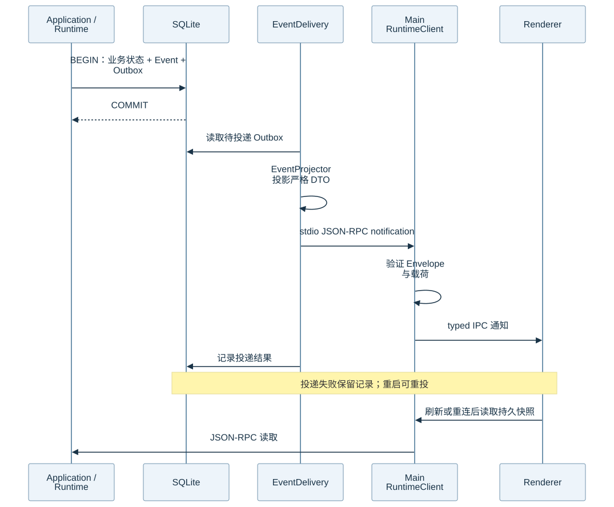

# 持久化、事件、恢复与关闭

SQLite 是业务事实来源。内存只保存协调状态、缓存和活跃资源。文件与 Blob 保存正文、输出和快照资源，并由持久记录关联。本文的核对基线见[组成总览](harness-overview.md)。

## 状态与事件怎样一起提交

图源：[Mermaid](diagrams/14-outbox.mmd)。EventDelivery 投递已提交的事实。通知可能需要重投，Renderer 仍可通过读取接口获取持久快照。

事务同时更新业务状态、Event 和 Outbox。EventProjector 根据事件和持久上下文生成严格 DTO。Runtime 通过 stdio JSON-RPC 发出通知，Main 验证后通过 typed IPC 交给 Renderer。

投递失败会保留记录和固定错误码。Runtime 重启可以重投未完成 Outbox。这一机制没有承诺网络或 UI 的端到端 exactly-once；读取快照和稳定实体身份仍是恢复展示所需的部分。

## 哪些状态需要持久化

| 事实组 | 主要对象 | 恢复时的用途 |
| --- | --- | --- |
| 任务 | Session、Run、队列、Segment、Step 与 Item | Runtime 判断任务位置与会话顺序。 |
| 模型 | Profile、ContextPlan、Snapshot、Attempt 与请求组 | Runtime 复查原输入和已消耗预算。 |
| 工具 | ToolCall、Attempt、Intent、结果与执行开始事实 | Runtime 区分未执行、已完成和未知结果。 |
| 人机协作 | Approval、Grant、输入请求、Plan 与子任务依赖 | Runtime 恢复合法等待并沿原契约继续。 |
| 扩展与资料 | Extension Snapshot、记忆版本、读取记录、检索来源 | Runtime 核对固定内容与撤销状态。 |
| 版本操作 | Checkpoint、Fork lineage、Worktree 生命周期与快照引用 | Runtime 恢复或拒绝已经失效的工作空间操作。 |

Repository 和 Mapper 将数据库行映射为边界模型。Raw SQL、条件更新和短事务继续表达状态转换。Schema 升级需要在事务中更新结构和版本；迁移失败不能只留下新版本号。

## 启动恢复与关闭

图源：[Mermaid](diagrams/13-recovery.mmd)。图展示主要分类，实际恢复还会检查取消、工具尝试、审批指纹、请求组和资源引用。

| 中断位置 | 当前处理原则 | Runtime 不会推断什么 |
| --- | --- | --- |
| 安全纯模型阶段 | 系统满足恢复条件时重新排队，并沿用固定请求和预算。 | 系统不会恢复为一份新预算。 |
| 合法待审批、待输入或待子任务 | 系统按持久记录和固定契约恢复等待。 | 系统不会把等待当作用户已经同意。 |
| Intent 或工具执行未结束 | 系统根据实际记录标记中断或未知结果。 | 系统不会自动重放原副作用。 |
| 结果已提交、通知未投递 | 系统重投 Outbox。 | 系统不会再次执行业务操作来制造通知。 |
| Hook 已启动但无结果 | 系统保存 unknown 调用事实。 | 系统不会假设 Hook 没有改变外部状态。 |

未知结果继续留在工具和历史记录中。它不是要求用户核验、禁止后续工具或阻止 Run 完成的门。已知文件恢复可以观察当前状态，但不会重放操作，也不把历史失败结果改写为成功。

Supervisor 先停止接纳并请求取消，再等待 Worker、Managed Task、Shell、模型 Lease、MCP、Hook 和后台服务释放资源。ResourceRegistry 提供活跃资源事实与超时诊断。系统只有达到资源静止后才正常关闭存储；超时需要保留明确错误。

## 备份与回退

完整数据备份保存一致的 SQLite 与被引用资源。恢复到新目录后，Runtime 检查归档路径、体积、SQLite 完整性、正文和 Blob 引用。Workspace 与模型凭据不在该备份范围。

数据库回退、代码回退和 Workspace Rewind 是不同操作。旧 Runtime 不能读取新 schema 时，维护者需要使用兼容备份，而非仅回退代码。当前记忆备份格式的具体边界见[记忆专题](memory.md#存储与恢复限制)。

## 源码与测试入口

| 机制 | 生产源码 | 相关测试 |
| --- | --- | --- |
| 事务与持久结构 | [database.py](../../runtime/eidos_runtime/db/database.py)、[schema.py](../../runtime/eidos_runtime/db/schema.py)、[Repository](../../runtime/eidos_runtime/db/repositories/) | [类型化 Session](../../runtime/tests/test_typed_session_repository.py) |
| 事件投递 | [events.py](../../runtime/eidos_runtime/runtime/events.py)、[event_delivery.py](../../runtime/eidos_runtime/runtime/event_delivery.py)、[event_projector.py](../../runtime/eidos_runtime/runtime/event_projector.py) | [Outbox](../../runtime/tests/test_phase5c_event_outbox.py)、[投递恢复](../../runtime/tests/test_event_delivery_recovery.py) |
| 进程恢复 | [recovery.py](../../runtime/eidos_runtime/db/recovery.py)、[supervisor.py](../../runtime/eidos_runtime/runtime/supervisor.py) | [进程恢复](../../runtime/tests/test_phase5c_process_recovery.py)、[循环恢复](../../runtime/tests/test_loop_recovery.py) |
| 资源与备份 | [resource_registry.py](../../runtime/eidos_runtime/runtime/resource_registry.py)、[backup.py](../../runtime/eidos_runtime/db/backup.py) | [资源关闭](../../runtime/tests/test_phase5c_resource_registry.py)、[数据备份](../../runtime/tests/test_data_backup.py) |

取消竞争、SQLite 失败、审批恢复和真实进程关闭仍需要分别验证。返回[组成总览](harness-overview.md)。
