# Durable Agent Loop

Eidos 用自己的 Runtime Loop 管理任务生命周期。模型 SDK 负责请求机制，Supervisor、Engine 和 SQLite 共同约束执行顺序与状态提交。本文的核对基线见[组成总览](harness-overview.md)。

## 调用与控制流

图源：[Mermaid](diagrams/02-task-loop.mmd)。错误分支按具体错误决定继续、重试或结束；图中的回路不表示所有错误都会重试。

最小调用链是 `RuntimeServer → Application → RunSupervisor → RuntimeEngine → ContextBuilder → SamplingRuntime → ToolCallRuntime → ToolExecutionController`。工具结果提交后，Engine 开始下一轮。模型给出完成响应时，Engine 在校验和事务边界内提交完成事实。

| 对象 | 它记录什么 | 主要所有者 |
| --- | --- | --- |
| Session | 对话、工作空间与队列关系 | Application 与 Repository |
| Run | 一次执行目标、权限模式、模型快照与生命周期 | Supervisor 与 Engine |
| Execution Segment | 操作阶段、有效时间和运行遥测 | 长任务协调与持久化 |
| Step | 一次模型步及其固定上下文和工具契约 | Engine 与 StepContext |
| ModelAttempt | 一次模型请求的结果、用量、草稿与重试归属 | SamplingRuntime |
| ToolCall / ToolAttempt / Intent | 工具声明、尝试、执行前提和副作用状态 | 工具执行链 |

## 一轮怎样推进

1. Supervisor 从持久队列接纳 Run，并登记 Worker 和资源。
2. Engine 消费已到达的输入，解析规则，固定本次 Step 的上下文和工具定义。
3. SamplingRuntime 为请求保存 Attempt。流式文字可以进入草稿；草稿不能让残缺工具提前执行。
4. LoopDecisionEngine 根据完整响应和 Runtime 事实给出动作。Engine 的 `_settle_sample_boundary` 提交相应状态，并返回继续构建、执行工具或返回的控制结果。
5. 工具链保存结果。Engine 再检查取消、新输入、上下文压力与进展，决定下一步。

## 等待、取消与并发

Supervisor 按 Session 保持 FIFO。不同 Session 的 Run 可以共享一个 Workspace 并行工作。每个 Run 有自己的工具门控和 Shell 管理器。SQLite 的短事务与文件版本检查仍约束并发提交。

审批、用户输入和子任务等待有持久记录。恢复时，工具读取原 Step 的固定契约和 Run 权限。系统不需要重新使用已经撤销的模型请求正文来恢复审批。

取消先改变持久状态，再取消所属模型请求、进程和其他资源。迟到回调必须经过所属 Attempt、取消与版本检查。关闭流程继续等待受管资源；相关机制见[持久化与恢复](persistence-recovery.md)。

## 进展与完成边界

LoopGuard 使用语义 fingerprint 检查循环进展。固定 model-step 数和运行时长不是健康任务的自动终止条件。Segment rollover 也不是 Run 终态。

普通工具参数错误会反馈给模型。容量恢复会采用较小投影、分页或可取消的恢复路径。普通采样目前仍有[有限重试预算](model-gateway.md#断流与重试)。维护者不能把“工具错误可以继续”扩大为“任意 Provider 故障都能无限恢复”。当前有限预算与 `AGENTS.md` 的持续恢复要求仍需后续统一。

Run 成功表示 Runtime 按已实现规则完成提交。真实任务是否达到用户目标，还需要查看产物和验收证据。特殊 RunFinalizer 使用有界、无工具请求生成收尾说明。

## 源码与测试入口

| 事实 | 生产源码 | 相关测试 |
| --- | --- | --- |
| Worker、队列、取消与关闭 | [supervisor.py](../../runtime/eidos_runtime/runtime/supervisor.py) | [资源注册](../../runtime/tests/test_phase5c_resource_registry.py)、[循环恢复](../../runtime/tests/test_loop_recovery.py) |
| 循环与决策边界 | [engine.py](../../runtime/eidos_runtime/runtime/engine.py)、[decision.py](../../runtime/eidos_runtime/runtime/decision.py) | [模型 Turn 控制](../../runtime/tests/test_model_turn_control.py) |
| Step 与采样 | [step_context.py](../../runtime/eidos_runtime/runtime/step_context.py)、[sampling.py](../../runtime/eidos_runtime/runtime/sampling.py) | [Attempt 快照](../../runtime/tests/test_model_attempt_context_snapshot.py) |
| 异步 I/O 所有权 | [async_kernel.py](../../runtime/eidos_runtime/runtime/async_kernel.py)、[resource_registry.py](../../runtime/eidos_runtime/runtime/resource_registry.py) | [异步内核](../../runtime/tests/runtime/test_async_kernel.py) |

这些入口覆盖既有用例；本次文档补充没有重跑产品测试。返回[组成总览](harness-overview.md)。
