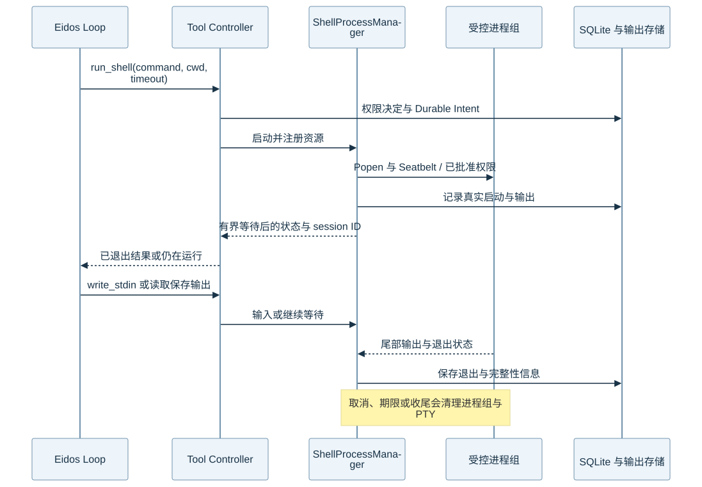

# 工具执行与 Shell 生命周期

Tool Runtime 把模型声明转换成有权限、有执行前提和真实结果的操作。工具实现可以不同，但参数、Intent、取消和结果提交需要进入共同边界。本文的核对基线见[组成总览](harness-overview.md)。

## 固定执行链

图源：[Mermaid](diagrams/10-tool-pipeline.mmd)。普通参数错误、权限拒绝和已执行但结果丢失具有不同含义。

最小调用链是 `ToolCallRuntime → ToolDispatcher → ToolExecutionController → Handler / ToolOrchestrator → 文件、进程或外部服务`。Tool Registry 固定工具定义、来源、Schema、执行策略和结果契约。MCP 工具也进入这条链。

| 阶段 | Runtime 核对什么 | 失败怎样表达 |
| --- | --- | --- |
| Validate | 参数、Schema 边界、工具可用性与契约 | 工具返回参数或契约错误，模型可以修正。 |
| Prepare | 当前内容、完整 Diff、文件身份、版本和操作范围 | 工具保留未执行事实，不猜测副作用。 |
| Permission | Run 模式、已有 Grant、本次扩权与必要人工审批 | Runtime 持久保存需要恢复的审批。 |
| Durable Intent | 本次操作的身份、授权与执行前提 | Runtime 在执行前提交记录。 |
| Execute | 操作是否真的开始，进程是否真的启动 | 仅有授权记录不能证明已经产生副作用。 |
| Verify | 当前结果、文件变化、响应格式与输出边界 | Runtime 区分结果失败与执行结果未知。 |
| Commit | ToolResult、执行状态、Event 和 Outbox | Runtime 在同一事务提交业务变化与事件。 |

可信文件 Handler 在准备阶段确认内容已相同时，可以返回内部 `execution_skipped` 和 `no_changes`。该路径没有进入真实执行，所以无需制造 Durable Intent。模型和外部工具不能通过参数设置这个内部标记。

## 文件写入

文件工具先读取当前内容，再生成 Base Hash 与完整 Diff。Runtime 在 Intent 后重新核验身份和版本。已有普通文件使用受控原地写入：Helper 打开并核验 fd，再截断、完整写入、fsync 和验证。新文件保留排他创建。

已截断后的失败可能已经改变文件。工具需要报告真实副作用。系统记录未知结果，但不会自动重试或回滚，也不要求用户核验后才能继续任务。

文件工具的范围、Skill 目录和高危路径规则见[权限与 Sandbox](permissions-sandbox.md)。`unidiff` 负责 Unified Diff 解析；Eidos 继续负责版本、权限、提交和核验。

## 并行与顺序

ToolCallRuntime 只并行执行连续且满足 `parallel_safe` 的只读片段，并按模型声明顺序汇总结果。副作用片段之间保留顺序。

每个 Run 有自己的 ToolConcurrencyGate。副作用门只覆盖该 Run 的提交与启动窗口；Shell、MCP 和网络等待不会长期持有该窗口。不同 Run 不共享这把锁。相同文件的冲突仍由文件身份与版本核验发现。

## Shell、等待与输出

图源：[Mermaid](diagrams/11-shell.mmd)。`yield_time_ms` 控制一次等待，进程的真实 timeout 独立生效。一次等待返回“仍在运行”时，Shell 资源仍属于该 Run。

Shell 使用明确 cwd、有界输出、进程组和有效权限。ShellProcessManager 管理管道 stdin/stdout/stderr、输出尾部和退出信息。Agent Shell 当前没有 PTY；Desktop Terminal 的 PTY 由 Main 单独管理。`write_stdin` 继续操作已经登记的进程。`read_tool_output` 可以读取保存的输出；它不会重启命令。

Shell 的 process nonzero exit 是进程结果。它不等同于工具基础设施失败。输出截断、输出尚未结束、进程仍在运行和最终退出也分别记录。

Run 取消、真实执行期限和收尾会清理所属进程组。运行中的 Shell 不能成为跨 Run 的调度配额。Runtime 重启也不能通过重新执行原命令来“恢复”未知结果。

## 结果投影与未知副作用

Runtime 保存原始结果，并向模型提供有界投影、必要状态与分页入口。MCP 已经返回有效 CallToolResult 后，后续输出 Schema 或内容转换失败可以使工具结果失败，但不能把已收到结果的执行重新说成未知。

已经进入外部调用、但结果丢失的操作需要记录未知状态。后续任务仍可继续、完成或取消。系统不自动重放这些操作。已知文件观察可以确认当前文件状态，但不能把原失败结果改写成成功。

## 网络搜索与产物交付

内置 `web_search` 使用用户选择并固定的服务配置，通过 RuntimeAsyncKernel 发送有界 HTTPS 请求。结果保留来源、摘要和已提供的发布时间。系统不补造日期，也不自动切换服务或提供通用网页抓取。搜索权限不授予 Shell 网络访问。具体结构见[当前网页搜索](../current/features/web-search.md)。

`declare_outputs` 为用户期望接收的独立终态文件提供交付身份。工具核验固定 Workspace 中普通文件的存在、大小与版本，并在返回前复核整个批次。声明保存在成功 ToolResult 中，工具不会读取全文或证明内容质量。普通项目修改和中间文件不因被写入就自动成为交付物。

Main 的预览管理器通过 Runtime 读取获得授权的文件资源。浏览器预览使用独立 partition、context isolation 和 sandbox，并限制导航与资源范围。预览、截图和标注提供查看与反馈入口，当前文档没有把它们描述为完整的自主浏览器操作循环。

## 源码与测试入口

| 机制 | 生产源码 | 相关测试 |
| --- | --- | --- |
| 注册与参数 | [registry.py](../../runtime/eidos_runtime/tools/registry.py)、[json_schema.py](../../runtime/eidos_runtime/tools/json_schema.py)、[tool_dispatcher.py](../../runtime/eidos_runtime/runtime/tool_dispatcher.py) | [工具上下文](../../runtime/tests/test_phase4a_tool_context.py) |
| 执行、Intent 与结果 | [tool_runtime.py](../../runtime/eidos_runtime/runtime/tool_runtime.py)、[tool_execution.py](../../runtime/eidos_runtime/runtime/tool_execution.py)、[tool_orchestrator.py](../../runtime/eidos_runtime/runtime/tool_orchestrator.py) | [控制器](../../runtime/tests/test_phase5b_tool_execution.py)、[未知结果恢复](../../runtime/tests/test_reconciliation_recovery_budget.py) |
| 文件提交 | [file_commit_helper.py](../../runtime/eidos_runtime/sandbox/file_commit_helper.py)、[workspace.py](../../runtime/eidos_runtime/tools/workspace.py) | [文件 Helper](../../runtime/tests/test_file_commit_helper.py)、[Patch](../../runtime/tests/test_codex_apply_patch.py) |
| Shell 与分页 | [shell_process_manager.py](../../runtime/eidos_runtime/runtime/shell_process_manager.py)、[shell.py](../../runtime/eidos_runtime/sandbox/shell.py)、[read_tool_output.py](../../runtime/eidos_runtime/tools/read_tool_output.py) | [Shell](../../runtime/tests/test_shell.py)、[输出投影](../../runtime/tests/test_shell_output_projection.py)、[收尾恢复](../../runtime/tests/test_shell_completion_recovery.py) |
| 产物与预览 | [declare_outputs.py](../../runtime/eidos_runtime/tools/declare_outputs.py)、[artifact-preview.ts](../../desktop/main/artifact-preview.ts) | [产物声明](../../runtime/tests/test_declare_outputs.py)、[预览](../../desktop/main/workspace-preview.test.ts) |

真实进程组、PTY 和 Seatbelt 行为需要原生验证。返回[组成总览](harness-overview.md)。
