# Workspace、代码理解与版本恢复

Eidos 将工作空间权限、代码检索和 Git 生命周期分开处理。检索帮助模型选择资料，文件工具负责真实内容核验，Git Kernel 管理受管 checkout 和恢复资料。本文的核对基线见[组成总览](harness-overview.md)。

## 代码理解与检索结构

图源：[Mermaid](diagrams/15-retrieval.mmd)。索引是派生资料；watchfiles 只提供失效提示。受控读取仍核对当前文件。

| 阶段 | 当前实现 | 交付给下一阶段的内容 |
| --- | --- | --- |
| Inventory | 系统核对 Root、文件范围、身份与 generation；pathspec 处理 ignore | 系统提供完整或带诊断的文件清单。 |
| Repository Map | 系统识别 Git 状态、目录、构建系统和测试命令 | Context 获得仓库概览及命令来源。 |
| AST / Symbol Index | Tree-sitter 解析 Python、TypeScript、TSX、JavaScript 和 Go | 系统保存符号、定义、导入和引用关系。 |
| 多路召回 | SQLite FTS5、精确路径与符号、RapidFuzz 模糊匹配、关系与任务线索 | Retriever 获得有界候选集。 |
| 排序与选择 | 系统合并信号，再按结果数、字节和时间预算选择 | ContextPlan 固定 evidence ID 与来源版本。 |
| 即时确认 | 文件工具与随包 ripgrep 执行当前读取和搜索 | 模型得到当前工具结果及可回读引用。 |

TaskQuery 从任务文本、显式路径与符号、当前 Diff、最近修改、此前读取、近期工具结果和路径规则形成查询。Retriever 需要 Inventory 与 Index 属于同一仓库和 generation，并且两者完整。

当前 ranking v1 将各信号分数相加。精确 Symbol 为 8，精确路径为 7，当前 Diff 为 6，最近修改为 4，此前读取与近期工具结果各为 3，路径规则为 2。定义、导入、引用、BM25、模糊度、语言和测试关系还有独立分量。生成文件和 vendor 文件带负分。这些数值是当前实现参数，不是跨任务质量保证。

各召回通道有限额，合计候选最多 256。默认查询最多选择 12 个结果，证据预算 128 KiB，deadline 500 ms。预算是工作边界；它不保证任意仓库都能在相同时间内得到完整最佳结果。

## Workspace 与版本操作

图源：[Mermaid](diagrams/16-workspace.mmd)。详细 Git 生命周期、归档和恢复协议见已有的 [Git Worktree Kernel](git-worktree.md)。

| 类型或操作 | 当前语义 | 需要保留的边界 |
| --- | --- | --- |
| Local Session | Session 使用原项目 checkout。 | 多个 Session 可以并行共享文件；提交仍需版本校验。 |
| Managed Worktree | 系统管理独立 checkout、身份、状态和资源引用。 | 工作树存在不代表运行任务自动独占所有资源。 |
| Projectless | 普通 Session 使用独立私有 Workspace。 | 系统不因此开放整个 Eidos 数据目录。 |
| Checkpoint / Rewind | 系统保存恢复资料并按前提恢复对应范围。 | 文件回退不能撤销已发生的 Shell 网络、MCP 或其他外部副作用。 |
| Fork | 系统固定历史与 lineage，再创建正常 Session。 | Local / Projectless 可以共享当前目录，独立 Worktree 分叉按快照恢复。 |
| Handoff / Archive | 系统管理 Local 与 Worktree 切换、快照、归档和恢复。 | 系统需要在各阶段核对 Git、文件和持久生命周期。 |

模型上下文、磁盘文件、Git HEAD 和 Checkpoint 不是同一个版本。维护者诊断时需要分别读取它们。重建检索索引不能修复文件版本冲突，Workspace Rewind 也不能代替业务数据恢复。

## 当前边界

系统没有用向量库替代当前检索链。现有词法、符号和模糊召回不能保证所有语义改写都命中。大型仓库、缓存失效、路径替换和并行改动需要对应定向验证；索引命中不能证明文件安全或测试通过。

## 源码与测试入口

| 机制 | 生产源码 | 相关测试 |
| --- | --- | --- |
| 清单与索引 | [inventory.py](../../runtime/eidos_runtime/repo_intelligence/inventory.py)、[map.py](../../runtime/eidos_runtime/repo_intelligence/map.py)、[index.py](../../runtime/eidos_runtime/repo_intelligence/index.py) | [Inventory](../../runtime/tests/test_repository_inventory.py)、[Index](../../runtime/tests/test_repository_index.py) |
| 查询与排序 | [query.py](../../runtime/eidos_runtime/repo_intelligence/query.py)、[retrieval.py](../../runtime/eidos_runtime/repo_intelligence/retrieval.py) | [查询](../../runtime/tests/test_repository_task_query.py)、[检索](../../runtime/tests/test_repository_retrieval.py) |
| 缓存与即时搜索 | [watcher.py](../../runtime/eidos_runtime/repo_intelligence/watcher.py)、[search_driver.py](../../runtime/eidos_runtime/workspace/search_driver.py) | [Watcher](../../runtime/tests/test_repository_watcher.py)、[缓存](../../runtime/tests/test_repository_cache.py) |
| Git 与恢复 | [git/manager.py](../../runtime/eidos_runtime/git/manager.py)、[checkpoints.py](../../runtime/eidos_runtime/application/checkpoints.py)、[session_fork.py](../../runtime/eidos_runtime/application/session_fork.py) | [Managed Checkpoint](../../runtime/tests/test_checkpoint_managed_worktree.py)、[lineage](../../runtime/tests/test_checkpoint_lineage.py) |

返回[组成总览](harness-overview.md)。
