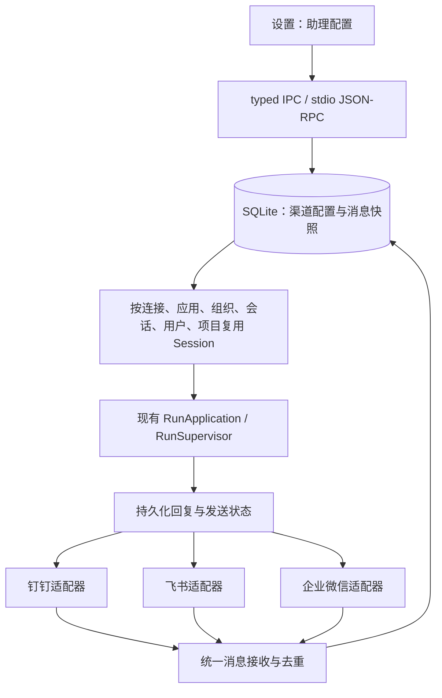

# 飞书与微信渠道接入方案

> 文档分类：设计与实施记录。本文保留记录时的方案、分支状态和验证范围。当前行为请以 [当前说明](../README.md#当前说明)、源码和测试为准。

## 结论与范围

Eidos 可以复用钉钉已经建立的消息落库、Session、Run、审批和回复记录链路。平台适配器仍然需要分别处理连接、身份、消息格式和发送回执。接入不是只替换凭证字段。

本次代码实现飞书和**企业微信**。这个选择沿用“设置 → 助理”中原有的企业微信入口。“个人微信”是另一种产品入口。本文也记录其官方方案，但当前代码不包含个人微信扫码登录。

| 渠道 | 本机接收方式 | 用户填写的凭证 | 回复方式 | 本次状态 |
| --- | --- | --- | --- | --- |
| 钉钉应用机器人 | Stream 长连接 | Client ID、Client Secret | OpenAPI | 保留现有能力 |
| 飞书自建应用机器人 | 官方 SDK WebSocket 协议 | App ID、App Secret | OpenAPI 回复原消息 | 已实现文字消息 |
| 企业微信智能机器人 | 官方 SDK WebSocket 协议 | Bot ID、Secret | 同一长连接主动发送，等待回执 | 已实现文字消息 |
| 个人微信 iLink | HTTPS 长轮询 | 扫码取得 Bot Token | HTTPS，回传会话上下文 | 已调研，本次未实现 |

飞书官方文档说明了[长连接订阅方式](https://open.feishu.cn/document/server-docs/event-subscription-guide/event-subscription-configure-/request-url-configuration-case)。飞书团队目前提供独立的 [lark-channel-sdk](https://github.com/larksuite/channel-sdk-python)。企业微信团队提供 [Python SDK](https://github.com/WecomTeam/wecom-aibot-python-sdk) 和 [Node SDK](https://github.com/WecomTeam/aibot-node-sdk)。这些连接都由本机主动建立，不需要给 Eidos 增加公网回调服务。

## 最小调用链

Eidos 仍然通过现有 Runtime 启动和关闭渠道服务。每个渠道单独连接和重试。一个渠道连接失败，不会取消其他渠道的连接。Run 仍然使用现有队列、审批、取消、Durable Intent 和结果核验。

## 飞书配置与处理

用户在飞书开放平台创建自建应用，并开启机器人能力。应用需要单聊读取权限 `im:message.p2p_msg:readonly`、群聊 @ 消息权限 `im:message.group_at_msg:readonly` 和发送权限 `im:message:send_as_bot`。用户在 Eidos 填写 App ID 和 App Secret，选择模型和执行位置，并启用保存。连接建立后，用户在飞书后台选择“使用长连接接收事件”，订阅 `im.message.receive_v1`，再发布应用并设置可用范围。用户需要把机器人加入目标群。

Eidos 先取得 tenant_access_token，再查询机器人身份。Eidos 使用机器人真实的 open_id 判断 mentions，不把“@全体成员”或其他机器人的提及当作当前机器人的提及。适配器处理用户发送的单聊文字和群聊 @ 文字。适配器忽略机器人、系统来源和未知会话类型。适配器不把图片占位文字当作文字指令。未支持的消息类型会收到文字提示。

Eidos 使用收到的 tenant_key、chat_id、发送者 open_id 和 message_id 建立路由与回复目标。用户不需要额外填写 Tenant ID、Bot Open ID 或 Chat ID。回复调用原 message_id 的 reply 接口。Eidos 只有在平台返回 message_id 回执后才记录 sent。HTTP 超时、服务端异常或缺少回执会记录 unknown。系统不会自动重发 unknown。平台明确返回限流或 Token 失效时，系统才按已有记录稍后重试。

飞书的高层 FeishuChannel 接口会建立额外线程和事件循环。Eidos 没有使用这个入口。Eidos 在现有 AnyIO Kernel 中管理 socket、读取和心跳任务。官方 SDK 继续处理二进制帧、分片、心跳内容和 ACK。回调会先完成 SQLite 短事务，再让 SDK 返回 ACK。数据库写入失败时，SDK 返回失败 ACK。

这一适配使用固定版本 SDK 的内部接口。相关代码集中在 `infrastructure/feishu_stream.py`。SDK 升级时，维护者必须重新检查这些接口，并运行分片、ACK、关闭和打包验证。[SDK 参考文档](https://github.com/larksuite/channel-sdk-python/blob/main/docs/reference.md)与[传输实现](https://github.com/larksuite/channel-sdk-python/blob/main/lark_channel/ws/client.py)是后续检查入口。

## 企业微信配置与处理

用户需要创建**智能机器人**，选择 API 模式和长连接，取得 Bot ID 和 Secret，并设置可用范围。普通群机器人 Webhook 不能替代这个入口。用户在 Eidos 填写凭证，选择模型和执行位置，并启用保存。

Eidos 主动连接 `wss://openws.work.weixin.qq.com`。官方 SDK 负责订阅鉴权、心跳内容、发送队列和回执匹配。Eidos 只在鉴权成功后显示“已连接”。Eidos 为鉴权设置超时，并在退出时取消和等待心跳及尚未结束的发送任务。SDK 原始日志由固定日志处理器隔离。

企业微信回调中的 `aibotid` 必须与已配置 Bot ID 一致。单聊使用发送者 userid，群聊使用 chatid。回调不要求用户再填写 CorpID、AgentID 或群 ID。企业微信的群机器人回调没有钉钉的 `isInAtList` 字段。Eidos 按平台投递给机器人的群回调处理消息，不额外编造一个 @ 字段，也不解析显示昵称来鉴权。群触发范围由平台的智能机器人配置决定。这个差异可以从[官方 SDK 消息结构](https://github.com/WecomTeam/aibot-node-sdk#-消息帧结构)核对。

Eidos 使用 SDK 的主动发送通道回复到原会话。该通道不依赖临时 response_url，也不受首次流式回复窗口限制。单聊目标是 userid，群聊目标是 chatid。当前实现只发送最终 Markdown 回复，不向平台逐条发送工具输出。回复按 UTF-8 切成不超过 3000 字节的段。这个值是本次实现采用的保守限制。

平台成功回执对应 sent。平台明确拒绝对应 failed。发送中断、回执超时或关闭期间中断对应 unknown。尚未鉴权时，系统不发送，记录稍后重试。系统不会自动重发 unknown。实际平台发送权限和限频仍需通过真实机器人验收。

## 个人微信调研

腾讯提供 [openclaw-weixin](https://github.com/Tencent/openclaw-weixin) 及其[后端协议说明](https://github.com/Tencent/openclaw-weixin/blob/main/docs/protocol.md)。这个方案使用二维码登录、Bot Token 和 HTTPS 长轮询。它不是填 App ID/Secret 的企业应用接入。

如果后续接入个人微信，Eidos 需要增加二维码登录与状态轮询、过期重登、受保护的 Token 存储、持久化 get_updates_buf 游标，以及发送时的 context_token 处理。游标必须在消息落库后推进，避免重启丢消息。Eidos 还需要核对登录后的主机切换与重定向规则，并对返回地址做校验。

官方文档说明，其协议记录来自当前客户端类型和请求实现，不代表完整服务端契约。因此，Eidos 不能仅凭协议字段存在就承诺普通微信群 @、任意主动推送或所有账号可用。个人微信需要单独确定交互范围并进行账号验收。本次没有安装 OpenClaw，也没有把其 Agent Loop 带入 Eidos。

## 共享数据、权限和兼容性

`channel/read` 和 `channel/save` 增加可选 channel，允许 dingtalk、feishu、wecom。省略时仍然读取或保存钉钉。三个连接分别使用配置版本和凭证引用。设置页分别显示连接状态、表单和最近回复。

当前五张渠道表已经可以保存多个连接，因此本次没有改变表结构或 Schema v30。连接 JSON 增加 channel；Repository 将缺少该字段的旧记录视为钉钉。旧的消息去重 ID 和 Session 路由保持不变。不同渠道有不同的连接 ID，因此同名消息 ID 不会相互覆盖。公开响应不返回 Secret 或文件引用。

新 Desktop 和 Runtime 需要配套更新。旧 Runtime 不认识新连接 JSON，不能直接读取新格式；回退前需要恢复改动前的数据备份。旧请求省略 channel 的兼容仅指新 Runtime 接受旧请求，不代表旧 Runtime 能读取新数据。

三个渠道继续默认支持单聊，并沿用原有审批选项。用户选择完全访问时，Desktop 继续显示危险二次确认。Runtime 继续核对保存的确认版本。平台消息不能切换模式，不能替代本机授权，也不能直接创建记忆或定时任务。三个渠道不会增加用户或群白名单。

## 依赖决策

本次新增 `lark-channel-sdk==1.4.0` 和 `wecom-aibot-python-sdk==1.0.2`。前者采用 MIT 和 BSD-3-Clause，后者采用 MIT。两者支持当前 Python 版本。Eidos 复用官方连接协议实现，并保留一个很薄的生命周期适配。Eidos 没有自行实现分片协议、ACK 协议或第二套 Agent Loop。

锁文件新增 pycryptodome、requests-toolbelt、pyee 等传递依赖。WebSocket 传输直接使用已有的 websockets 库，本次将其显式列为生产依赖并固定为 15.0.1。飞书 SDK 要求 websockets 小于 16，因此锁文件将 websockets 从 17.2 调整为 15.0.1。钉钉定向收发测试必须覆盖这个共同依赖变化。pycryptodome 有原生扩展，因此本次需要验证 macOS arm64 Bundle。Eidos 不要求用户预装 SDK 或其他常驻服务。

## 验证与待办

本次检查使用模拟平台传输、真实 SQLite、真实 Runtime 和隔离 Electron 页面。检查结果不代表已经用真实飞书或企业微信凭证收发成功。

- Runtime 渠道测试覆盖去重、旧数据读取、配置版本、独立回复记录、等待审批、完全访问、取消、重启和不确定发送。
- SDK 测试覆盖飞书分片与成功/失败 ACK、企业微信鉴权和发送回执、超时、关闭，以及单个渠道失败时其他连接继续运行。
- Main/Runtime 测试覆盖三个渠道的真实子进程协议、凭证脱敏、配置版本和重启保留。
- Renderer 与 Electron 检查覆盖三个可用入口、平台凭证标签、保存、危险确认和不同宽度。

最终通过数量与构建结果在 `current-channels.md` 记录。开发过程没有运行 Full Suite。

维护者仍需使用真实飞书与企业微信应用，分别验证单聊、群聊 @、连续消息、网络恢复、应用发布范围和平台发送限频。媒体、附件、卡片、平台侧审批和个人微信扫码登录不在本次代码范围内。

生产依赖审计仍报告已有的 pydantic-ai-slim 2.43.0 的五个漏洞：PYSEC-2026-4284、4285、4286、4290、4291。本次审计没有发现新增 SDK 引入的其他漏洞。模型层依赖升级需要另外验证，当前不能把生产依赖审计记为通过。
