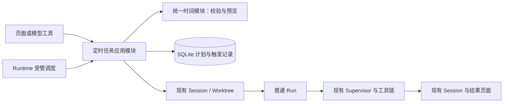

# Eidos 本地定时任务：修订方案 V3

> 文档分类：设计与实施记录。本文保留记录时的方案、分支状态和验证范围。当前行为请以 [当前说明](../README.md#当前说明)、源码和测试为准。

修订日期：2026-10-15。本文保留实现前的方案与调研依据。当前实现、协议和验证边界以 [当前本地定时任务](../current/features/automations.md)、生产代码与测试为准。

Session 工具的参数、绑定、幂等、权限和失败处理见 [automation 详细设计](automation-tool-design.md)。本文中的 schedule/* 是 Desktop 与 Runtime 的协议接口；模型只使用一个内置工具 automation，通过 mode 处理管理操作。

工具延迟加载和实现前的来源、触发竞争及恢复缺口见 [方案复核](../research/scheduled-tasks-gap-review.md)。automation 默认 deferred，模型通过 tool_search 激活后在后续 Step 使用。

**本版采用本地 Runtime 调度。周期任务使用受限的五段 Cron，一次性任务使用明确时间戳。固定间隔只提供 10 分钟、30 分钟和 1 小时。模型提出规则，Runtime 校验并计算时间。产品不实现漏跑检测、补跑或云端执行。**

## 1. 对本轮想法的判断

| 想法 | 判断与采用方式 |
| --- | --- |
| 本版不考虑漏跑检测和补跑 | 该范围合理。系统启动、唤醒或恢复计划时，只计算当前之后的下一次时间，不检查历史时刻 |
| Eidos 只作为本地工具 | 该定位明确。本方案只使用当前 Electron Main、Python Runtime 和本地 SQLite |
| 固定间隔只允许 1 小时、半小时、10 分钟 | 该限制合理。界面、模型工具和 Runtime 使用相同限制 |
| 模型使用 Cron 设置执行时间 | 该方向适合周期任务。模型提交表达式，Runtime 返回实际时间；模型不自行计算后直接持久化 |
| 所有任务都用 Cron | 一次性任务需要例外。标准五段 Cron 没有年份，也不表示“执行一次后结束” |
| 模型只使用一个管理工具 | 本版采用 automation，mode 区分 view / create / update / delete / preview |
| sessionId 可选 | 创建时提供则复用已有 Session，不提供则每次新建；更新省略目标时保留原绑定 |
| 计划默认使用替我审批 | create 省略 approvalMode 时固定 auto_review，不继承当前对话的模式；用户可以显式选择 manual |

这里将“corn”按 Cron 理解。本方案将“测例执行时间”理解为设置规则，并预览未来执行时间。时间预览不运行任务正文。

本版还需要明确一个产品含义：Cron 的“每十分钟”默认按钟表刻度对齐。用户在 09:07 创建 `*/10 * * * *` 时，下一次是 09:10，后面是 09:20、09:30。该规则不表示从创建时刻开始每隔十分钟。

如果用户说“十分钟后只检查一次”，模型创建一次性任务。如果用户说“每十分钟检查”，模型创建按钟表对齐的周期任务。本版不额外增加“从任意起点持续计时”的第三套时间规则。

## 2. 竞品参考与 Eidos 现状

上一轮已经读取的 OpenAI 官方文档确认，桌面端任务既可以每次新建聊天，也可以回到原聊天；本地项目可以使用原目录或独立 Worktree。该信息属于上一轮调研快照。Eidos 按本轮用户要求定义两种会话方式。[OpenAI Scheduled tasks](https://learn.chatgpt.com/docs/automations)

Claude Code 桌面端支持本地计划、目录、模型、权限模式、Worktree 和执行历史。Eidos 可以参考这些本地能力。本版时间行为按用户本轮范围重新定义，不沿用上一版的历史时刻处理设计。[Claude Code Desktop scheduled tasks](https://code.claude.com/docs/en/desktop-scheduled-tasks)

当前源码提供以下可复用能力：

| 当前事实 | 本版采用方式 | 源码入口 |
| --- | --- | --- |
| Run 已经持久排队，同一 Session 使用 FIFO，不同 Session 可以并行 | 调度器创建普通 Run，现有 Supervisor 继续执行 | `db/repositories/runs.py:375`；`runtime/supervisor.py:240` |
| Runtime 已有 AnyIO Kernel、受管任务、取消和资源关闭 | 一个进程级调度模块使用现有生命周期 | `runtime/async_kernel.py`；`runtime/supervisor.py:688` |
| RunApplication 已有输入、模型、扩展与工作区校验 | 手动和定时入口共用这些检查 | `application/runs.py:305` |
| 手动 Run 需要 RPC 回包成功后放行 Worker | 定时入口使用“事务提交成功后放行”，保留手动入口原规则 | `application/runs.py:190` |
| create_run 支持外部事务连接和指定 Run ID | 触发记录、Run、用户 Item 和 Event/Outbox 可以原子关联 | `db/repositories/runs.py:122` |
| Session 已支持 Local、Worktree 和 Projectless | 任务沿用现有执行环境创建与身份校验 | `application/sessions.py:569` |
| Run Grant 绑定单次 Run，完全访问需要 Desktop 确认 | 定时触发不继承历史授权，也不生成虚假的确认标记 | `db/repositories/runs.py:606`；`protocol/methods.py:423` |
| macOS 关闭最后一个窗口不会退出应用，真正退出会关闭 Runtime | 应用仍运行时可以调度；完全退出后停止调度 | `desktop/main/main.ts:1492`、`:1502` |

当前 Schema 版本是 27。当前依赖没有声明 Cron 计算库。当前源码没有用户定时任务的管理接口。本方案需要新增迁移和协议，不改变现有控制通道，也不迁移整个 Runtime 的异步结构。

## 3. 用户可以创建什么任务

### 两种会话方式

| 方式 | 执行方式 | 例子 |
| --- | --- | --- |
| 独立任务 | 创建时不传 sessionId，Eidos 每次触发创建新 Session 和普通 Run | 用户要求每天早上检查项目并生成报告 |
| 原会话任务 | 创建时传入真实 sessionId，Eidos 在该 Session 创建普通 Run | 用户要求每十分钟继续检查当前部署 |

用户可以在侧栏“定时任务”页面创建任务。用户也可以在对话中直接要求创建任务。用户说“在这里继续”时，模型显式传入当前真实 sessionId；Runtime 不把缺省 sessionId 解释成复用当前 Session。

有 sessionId 时，项目归属从目标 Session 解析，额外 projectId 必须与它一致。无 sessionId 时，projectId 字符串表示指定项目，projectId=null 表示无项目，两者都省略时继承调用 Session 的项目或无项目归属。Runtime 在保存结果中返回明确绑定，不让模型和用户猜测。

Git 独立任务可以选择 Local 或新 Worktree。Worktree 每次使用已选择的 ref 解析真实 commit，不默认复制未提交改动或联网 fetch。Non-Git 项目使用 Local。无项目独立任务复用现有 Projectless 私有目录创建流程。

原会话任务沿用目标 Session 的执行绑定。目标被删除或目录身份校验失败时，系统暂停该计划并给出原因。系统不静默换一个目录执行。

### 两种时间数据

周期任务保存 kind 与 schedule，工具请求也使用相同结构：

```json
{
  "kind": "cron",
  "schedule": {
    "expression": "*/10 * * * *",
    "timezone": "Asia/Shanghai"
  }
}
```

一次性任务保存：

```json
{
  "kind": "at",
  "schedule": {
    "runAt": "2026-10-16T09:00:00+08:00",
    "timezone": "Asia/Shanghai"
  }
}
```

上例只说明数据形式。实际时间由用户请求与 Runtime 当前时间决定。Runtime 在创建时拒绝已经过去的一次性时间。系统在持久化时保存对应 UTC 时刻，并保留展示时区。

周期任务只有规范化后的 Cron 是时间规则权威。界面可以用“10 分钟”等选项生成表达式，但系统不再同时保存一份可独立修改的 intervalMinutes 或 RRULE。

### 固定间隔只接受三档

| 用户选项 | 规范 Cron | 执行时刻 |
| --- | --- | --- |
| 每 1 小时 | `0 * * * *` | 系统在每小时的 00 分触发 |
| 每 30 分钟 | `*/30 * * * *` | 系统在每小时的 00、30 分触发 |
| 每 10 分钟 | `*/10 * * * *` | 系统在每小时的 00、10、20、30、40、50 分触发 |

Runtime 必须执行三档限制。模型不能通过 `*/5 * * * *`、`*/15 * * * *`、`0 */2 * * *` 或多组分钟列表绕过产品限制。系统不能只把界面下拉框限制为三个选项。

### 日历时间使用受限 Cron

| 用户请求 | 规范 Cron |
| --- | --- |
| 用户要求每天 09:00 执行 | `0 9 * * *` |
| 用户要求周一至周五 09:00 执行 | `0 9 * * 1-5` |
| 用户要求每周一 09:00 执行 | `0 9 * * 1` |
| 用户要求每月 1 日 09:00 执行 | `0 9 1 * *` |

本版只开放三档固定间隔，以及每天、每周指定日、每月指定日的单个日内时刻。每周可以选择多个星期。月份字段保持 `*`。系统只接收标准五段形式，不开放秒、年份、随机值、哈希值或非标准扩展。

Runtime 按标准 Cron 使用星期编号：0 表示周日，1 表示周一。Runtime 不允许同时限制日期和星期，以免用户遇到 Cron 中“日期或星期满足其一”的含义。

成熟解析器负责解析表达式。Eidos 只判断解析后的规则是否属于本版允许的形态。Eidos 不实现第二个通用 Cron 解析器。“工作日”表示周一至周五，不处理法定节假日和调休。

## 4. 模型如何在对话中创建任务

推荐调用链为：

```text
用户提出任务与时间
  → 模型通过 tool_search 精确搜索 automation
  → 下一 Step 提供完整定义与参数结构
  → 模型通过 sessionId 是否存在选择会话方式，并生成 at / Cron
  → 模型按需要调用 automation(view / preview) 查找计划或预览时间
  → automation(create / update) 校验并保存已获授权的任务
  → Runtime 返回实际计算的执行时间和配置版本
  → 模型回显任务名称、时间、时区与下一次执行
```

Runtime 负责解析时区和计算下一次时间。模型负责将用户要求转换成规则，不能把自己口算的 nextFireAt 当作持久事实。预览、创建、更新和实际调度必须使用同一时间模块。简单请求可以直接创建；create / update 本身会返回未来时间，系统不强制额外调用 preview。

例如，用户说“每十分钟在这个会话里检查部署，成功后停止”。模型通过 automation 提交 `*/10 * * * *` 和当前真实 sessionId，并把检查内容与停止条件写入任务指令。Runtime 返回真实任务 ID、revision 和接下来的五个时刻。任务执行确认部署成功后，只能使用该工具的受限 update 暂停自身计划。

automation 使用 view、create、update、delete、preview 五种 mode。view 有 id 时取详情，无 id 时分页列出。暂停与恢复通过 update 的 status 表示。update 必须携带真实 ID 和 expectedRevision，并只提交 changes；省略 target 始终保留原绑定。工具默认隐藏完整定义，仅在当前 Run 通过 tool_search 激活后进入下一 Step；系统不为 Session 永久保存激活状态。

create 允许 model={modelId, reasoningSelection}；省略时固定当前 Run 的有效选择。目标 Session 只决定上下文和执行位置，计划模型不改写该 Session 的用户下一轮选择。每次触发重新验证配置并固定快照，系统不静默更换已失效的模型。

create 同时接受 approvalMode，默认 auto_review（替我审批），可选 manual（请求审批）。update 使用 changes.approvalMode 修改，省略则保留原值。Runtime 将该值保存在计划中，并在每次接受 Run 时固定本次快照，不改变已入队执行或用户对话的审批选择。

如果用户已经明确要求创建任务，系统可以直接创建并回显结果。系统不为每次创建额外强制弹出确认框。用户只在时间、目标或执行内容存在歧义时需要补充说明。完全访问仍遵守原有人工确认规则。

如果用户要求每五分钟执行，Runtime 返回允许的三个间隔。模型不能静默把五分钟改为十分钟。模型只能在用户接受一个受支持选项后创建该周期任务。

## 5. 本版触发行为

| 情况 | 本版行为 |
| --- | --- |
| Eidos 持续运行并到达计划时间 | Runtime 认领本次时刻，准备环境并提交普通 Run |
| Eidos 启动、系统唤醒、Runtime 重启或用户恢复计划 | Runtime 只计算严格晚于当前时间的下次触发 |
| 周期任务曾经过了若干计划时间 | 系统不扫描这些时刻，不补写历史，不计算错过次数 |
| 一次性任务的时间已经过去，且尚未提交 Run | 系统停用该计划，不自动执行，不创建漏跑历史 |
| 同一计划上次仍在准备、排队、执行、待审批或待回答 | 系统跳过当前触发，历史仅记录“上次执行未结束” |
| 同一计划上次执行仍有 reconciliationRequired | 系统暂停本计划并保留原执行的核验入口，不创建新 Run 绕开原状态 |
| 原会话还有活动 Run 或已排队的用户消息 | 系统跳过当前触发，历史记录“会话忙碌”；系统不新增等待项 |
| 用户点击立即执行 | 系统幂等创建手动触发，不改变周期时间；同计划仍不重叠 |
| 用户暂停或删除计划 | 系统停止后续触发；已经提交的 Run 继续使用现有取消入口 |
| 用户编辑计划 | 系统重新计算未来时刻；已认领但未提交 Run 的旧版本触发作废；已提交 Run 保留原快照 |
| 一次性任务已经提交 Run | 系统停用该计划；Run 失败不会让计划再次触发 |

调度模块正常运行时可以每 30 秒以内检查一次当前时间。本版 Cron 使用分钟精度。正常检查在计划分钟内到达时，可以认领该分钟的触发。检查若已经跨过计划分钟，模块直接从当前时间计算下次时刻，不再执行旧时刻。

启动与唤醒的处理必须先更新未来时间，再恢复调度。这样，09:05 启动 Eidos 时，`*/10 * * * *` 的下一次是 09:10，`0 * * * *` 的下一次是 10:00。系统不会先处理内存或数据库中残留的 09:00 时间。

本版不增加补跑窗口、历史时间游标、唤醒扫描、等待触发合并或时效队列。系统在清醒运行时因为忙碌而跳过当前触发，属于当前调度判断，不属于漏跑检测。

周期计划保存明确的 IANA 时区。Runtime 使用带时区的时间计算，并按 UTC 识别触发时刻。创建、编辑和预览始终使用相同计算规则。系统不因本机展示时区变化静默修改计划时区。

## 6. 推荐实现



时间模块的 Interface 接收时间规则、基准时间和受限预览数量，返回规范规则及未来时刻。它将 Cron 库、允许的规则形态、时区和错误处理放在同一个 Implementation 中。页面、模型工具和调度器共用这一 Interface。

Runtime 只维护一个调度模块。AnyIO 负责可取消等待，SQLite 决定计划是否启用，以及某次触发是否已经提交。下一次时间可以作为可重建内存缓存，不作为持久化历史时间游标。

调度模块不等待完整 Run。Git 与环境准备使用现有受管任务。系统不为每个计划创建常驻线程，不新增全局 Run 上限，也不增加跨 Run 的共享 Workspace 锁。当前计划不重叠和当前 Session FIFO 分别保留各自的作用范围。

### 最小持久数据

| 对象 | 本版字段 |
| --- | --- |
| scheduled_tasks | 名称、任务正文、配置版本、启用状态、会话方式、目标 Session 或项目、执行环境、模型设置、审批模式、at / Cron 与时区 |
| scheduled_occurrences | 计划 ID、计划时刻或手动 operation ID、配置快照、准备状态、Run / Session ID、准备失败或忙碌原因、创建与提交时间 |
| 现有 Run / Item / Approval | 系统保存明确执行来源，以及原有执行、回答、工具、权限、取消和终态事实 |

系统不增加补跑策略、补跑窗口、漏跑计数、离线历史范围或触发合并字段。

定时触发通过 `(task_id, scheduled_for_utc)` 唯一约束去重。手动触发使用 operation ID 去重。触发记录只表示准备、已提交、忙碌跳过或准备失败。Run 继续决定执行中、待审批、成功和失败。界面不依赖第二套执行状态机。

### 一次触发的事务与恢复

1. Runtime 检查计划是否启用、当前触发是否有效、计划是否已有未完成执行。Runtime 在短事务中认领唯一触发，并提交 Event/Outbox。
2. Runtime 在事务外准备 Session 或 Worktree。准备操作复用现有持久生命周期，并使用稳定的 occurrence operation ID。
3. Runtime 在事务外核验工作区身份并准备权限。Runtime 在提交 Run 的同一短事务内重新检查启用状态、认领版本、同计划占用、目标 Session 忙碌条件、原执行核验状态及持久目标绑定。版本已改变的旧准备触发不再入队。事务中不运行 Git 或其他长时间 I/O；工具执行仍保留原有身份和权限核验。
4. Repository 在同一短事务中写入 queued Run、用户 Item、触发与 Run 的关联、Event 和 Outbox。
5. Runtime 在事务成功后唤醒现有 Supervisor。

当前 `RunApplication.start()` 把校验、入队和 RPC 回包确认放在同一用例中。实施时需要提取共用校验与入队逻辑。手动入口继续在回包成功后放行。定时入口在自己的持久事务提交后放行，不能调用虚假的 `mark_response_delivered()`。

“本版不补跑”不改变已经接受的 Run 的恢复语义。已经提交的 Run 继续按现有恢复与 Reconciliation 规则处理。只有准备记录、尚未提交 Run 的旧触发，在重启后标为中断；系统只收敛已开始的 Worktree 生命周期，不自动重新提交这个触发。用户需要时可以点击立即执行。

Run 的唯一关联只能防止重复创建，不能证明任意外部副作用只发生一次。已有 Durable Intent、文件版本校验、取消和 Reconciliation 继续保留。

### 实现采用的协议

| 方法 | 用途 |
| --- | --- |
| schedule/execute | command.mode 统一处理 view / create / update / delete / preview；更新使用预期配置版本检查 |
| schedule/runNow | Runtime 幂等创建手动执行 |
| schedule/history | Runtime 分页返回实际触发历史与关联 Run 状态 |
| schedule/refresh | Desktop 在系统唤醒后要求 Runtime 重算未来时刻 |

automation 与页面调用同一应用模块。首版所有 mode 顺序执行。可信内置 Runtime 对已校验命令区分只读与写入：view / preview 不提交 Durable Intent，创建、更新与删除继续经过现有 Validate、Permission、Durable Intent、Execute、Verify 和 Commit 流程。实际调用类别需要在屏障和取消处理前固定；该分类属于待实现的小范围契约改动，不是当前已有能力。模型不能通过 Shell 写调度文件绕过流程。Python DTO 与 Desktop 契约继续使用同一 Schema 源。用户取消 Run 和处理审批继续使用现有协议。

自动输入需要在接受 Run 时保存持久来源，并与普通用户输入区分。它不授予计划管理权限，也不进入自动记忆学习。重新生成通过原逻辑请求复用已经发生的计划变更，不因新 Run / Item ID 再创建计划。模型、扩展变化与目标删除等具体处理见方案复核。

## 7. 权限与结果

本版计划审批模式默认 auto_review（替我审批），用户可明确选择 manual（请求审批）。该默认值独立于创建对话和目标 Session。替我审批复用现有审查与人工回退规则；高危请求仍由用户决定。任务需要人工处理时进入现有等待状态，并在页面展示具体原因，同计划后续时刻按忙碌规则跳过。旧 Run Grant 不自动复制到下一次执行。

根 AGENTS.md 当前要求 full_access Run 由用户在 Desktop 确认并创建。自动触发不得自行填入 full-access-v1 来冒充确认。本版不新增跨 Run 的持久授权，也不开放自动触发的 full_access。该限制不改变现有手动 Run。

侧栏增加“定时任务”。列表显示名称、是否启用、规则说明、下次执行和最近结果。详情提供编辑、暂停、恢复、立即执行、删除和实际触发历史。用户点击历史后打开现有 Session，继续查看回答、Diff、产物与审批。

失败、待审批和待回答进入待处理结果。首版先使用应用内结果提示。系统通知可以作为同一目标内的后续提交，不承担计划状态权威。计划删除默认保留历史 Session 和文件。

## 8. Cron 依赖取舍

本版优先评估 croniter，仅使用它的 Cron 解析与未来时间计算。项目官方文档提供 `get_next()`、带时区计算和查找跨度限制。[croniter 官方仓库](https://github.com/pallets-eco/croniter)

PyPI 当前元数据显示，croniter 使用 MIT 许可，支持 Python 3.11/3.12。该信息支持把它列为候选，但不等于已经通过 Eidos 的依赖审计或 macOS Bundle 验证。[croniter PyPI](https://pypi.org/project/croniter/)

| 方案 | 本版取舍 |
| --- | --- |
| datetime / zoneinfo | 系统使用标准库处理一次性时间、UTC 和时区 |
| croniter | 系统优先评估其五段 Cron 解析与 next-time 计算 |
| APScheduler 完整 Scheduler | 系统已有 SQLite、Run 执行和恢复，本版不增加另一套任务存储与执行器 |
| APScheduler 3.x CronTrigger | 该工具可以单独使用，但其星期数字与标准 Cron 存在差异，本版优先使用符合所选规则含义的 Cron 计算库 |
| python-dateutil / RRULE | 本版不再使用 RRULE，方案不为此增加依赖 |
| 系统 crontab 或每任务一个 launchd Job | 本版不使用它们存储或执行 Eidos 计划 |

APScheduler 3.x 官方文档说明，星期编号 0 表示周一。它与本版采用的标准 Cron 编号不同。[官方 CronTrigger 文档](https://apscheduler.readthedocs.io/en/3.x/modules/triggers/cron.html)

Runtime 只接收本版支持的表达式形态，并限制表达式长度、计算跨度和预览数量。维护者必须用候选版本验证日历日期、时区和异常表达式。通用 Cron 解析交给依赖；三档固定间隔和允许的日历形态由 Eidos 决定。

实施时新增依赖需要同步 pyproject.toml、uv.lock、最小集成测试、Deptry、pip-audit 和 Bundle 验证。本次不安装依赖，也不预先声称验证通过。

## 9. 本地生命周期与实施顺序

Eidos 完全退出、电脑关机或休眠时，计划不会执行。macOS 关闭窗口后，只要 Main 和 Runtime 仍在运行，调度可以继续。本版不增加常驻守护进程、系统唤醒或持续防休眠设置。

系统唤醒时只重置未来时间计算，不触发历史扫描。退出时，系统先停止新触发，再按现有流程取消或关闭 Run 和 Runtime。用户返回应用时，系统重新启用未来调度。

本版建议围绕同一目标分成四个可审查的提交：

1. 维护者增加受限 Cron / at DTO、统一时间模块、预览与规则校验。
2. 维护者增加两张表、迁移、唯一触发与普通 Run 原子关联。
3. 维护者接入受管调度、两种会话方式、忙碌跳过和本地退出流程。
4. 维护者接入页面、模型工具和执行历史，并同步当前文档与协议 Fixture。

本轮不增加通用工作流编辑器、多项目扇出、任务依赖图、持久权限或费用预算模块。

| 验收范围 | 必须证明的结果 |
| --- | --- |
| 规则限制 | Runtime 只接受三档固定间隔与允许的日历规则；模型无法绕过限制 |
| 时间预览 | 预览与真实计算一致；09:07 创建每十分钟任务后，下次为 09:10 |
| 一次性任务 | 系统只提交一次；系统拒绝创建过去时间的任务 |
| 本地重启与唤醒 | 系统只计算未来时刻，不补写或执行旧触发 |
| 忙碌情况 | 同计划和原会话忙碌时跳过当前触发；系统不积累等待项 |
| 原子性 | 认领、准备和入队发生竞争或崩溃时，系统不重复创建 Run |
| 已接受 Run 的恢复 | 已提交 Run 保留原恢复规则；未入队旧触发不会自动重新执行 |
| 权限与副作用 | 历史授权不跨执行复用；未知副作用不被重试；取消不被迟到结果覆盖 |
| 产品操作 | 暂停、恢复、编辑、删除和立即执行的含义与页面一致 |
| 生命周期 | 调度在退出前停止接收新触发，资源能够正常关闭 |

实施验证优先使用时间模块、Runtime、迁移、协议、Main 和 Renderer 的定向测试。生命周期变化需要 Electron smoke；权限物化变化需要真实 Seatbelt。Full Suite 只在用户明确要求时执行。

本次只修订总方案、automation 工具设计和源码复核三份文档。生产代码、依赖、Schema 和协议均未修改。相关定向测试、构建、原生验证和 Full Suite 均未运行。工作区已有的其他修改不属于本次修订。
