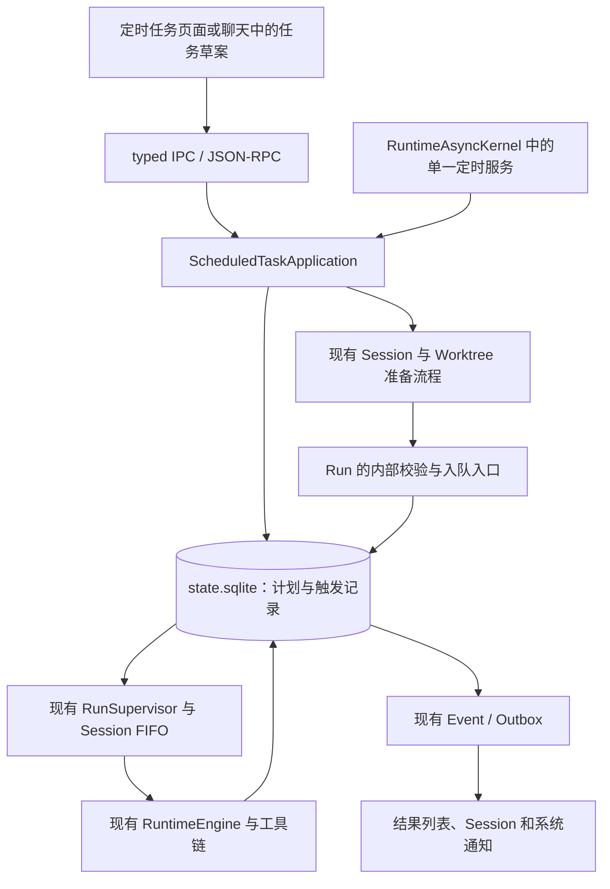

# Eidos 定时任务：竞品调研与推荐方案

调研日期：2026-10-15。本文是设计建议，不表示功能已经实现。竞品结论来自本次读取的官方文档。Eidos 结论来自当前工作区源码，并参考 `docs/current-*`。本次没有操作竞品账户、创建计划或做真实 UI 验收。

**我建议 Eidos 增加由 Runtime 管理的定时任务。产品同时支持“每次新建会话”和“回到原会话跟进”。两种方式共用计划、触发记录、权限检查和结果列表，实际执行继续使用现有 Run。第一版在本机执行。**

## 1. 竞品已经确认的能力

### Codex / ChatGPT 桌面端

OpenAI 当前把相关文档统一到 Scheduled tasks。旧 Codex Automations 文档地址已返回这一页面。桌面端支持以下行为：

- 用户可以用自然语言创建、修改计划，也可以使用自定义时间规则和 RRULE。
- 独立计划每次创建新聊天。会话内计划回到同一聊天，继续使用已有上下文。
- 本地项目可以直接运行，也可以使用独立 Git Worktree。非 Git 项目直接使用项目目录。一个计划可以选择多个项目。
- Scheduled 页面集中展示计划和执行结果，并通过未读标记提示用户处理。
- 任务可以使用 Skill、Plugin、模型和思考强度设置。本地文件任务要求电脑开机、应用运行、项目目录可用。
- 无人值守任务使用沙箱设置。组织允许时，任务采用 `approval_policy = "never"`；组织不允许时，任务退回所选权限模式的审批行为。

来源：[OpenAI Scheduled tasks](https://learn.chatgpt.com/docs/automations)。该页面也介绍 Web 的云端任务和事件触发，但这些能力不能直接等同于桌面本地项目任务。官方页面没有明确说明本地任务的补跑窗口和同一计划重叠规则。本文不推定这些细节。

### Claude Code 桌面端

Claude Code 的 Routines 页面区分 Local 和 Cloud。Local 每次创建新 Session，支持选择目录、模型、权限模式和独立 Worktree。Local 最短间隔为一分钟，应用和电脑必须保持运行。应用启动或电脑唤醒后，系统检查最近七天的漏跑，并只补最近一次。历史列表会说明跳过原因，包括上次任务仍在运行。任务可以保存后续运行使用的工具批准。

来源：[Claude Code Desktop scheduled tasks](https://code.claude.com/docs/en/desktop-scheduled-tasks)。该页面还说明本地任务会有固定的数分钟错峰延迟，因此“计划时间”不等于精确启动时间。

### Claude Cowork 与云端 Routines

Claude Cowork 的新计划可以远程执行，电脑休眠或桌面应用关闭时也能运行。每次执行拥有独立 Session。官方同时说明，需要本地文件或应用的计划只在本地运行；Pro、Max 在 10 月 6 日前创建的旧本地计划继续留在本机。

来源：[Claude Cowork scheduled tasks](https://support.claude.com/en/articles/13854387-schedule-recurring-tasks-in-claude-cowork)。所以，“Claude 定时任务必须一直开着电脑”已经不是适用于所有任务的结论。

Claude Code Cloud Routines 支持时间、API 和 GitHub 事件触发。用户从桌面、Web 或 CLI 管理同一云端账户中的计划。每次执行重新克隆所选仓库。云端环境与连接器决定任务能访问的内容。

来源：[Claude Code Routines](https://code.claude.com/docs/en/routines)。Claude Code 的 `/loop` 则属于会话内跟进工具，不能代替桌面持久计划。来源：[Claude Code scheduled prompts](https://code.claude.com/docs/en/scheduled-tasks)。

### Eidos 应采用的部分

| 产品需求 | 我建议 Eidos 采用的做法 |
| --- | --- |
| 日报、代码巡检、定期整理 | Eidos 每次创建新 Session，保留独立结果 |
| 等部署结束、跟进 PR、继续研究 | Eidos 回到原 Session，并提供停止条件与到期时间 |
| 用户管理后台工作 | Eidos 提供单独的“定时任务”入口和待处理结果 |
| 用户隔离代码修改 | Eidos 为 Git 独立任务默认推荐 Worktree，并明确起始分支 |
| 用户需要关机后执行 | Eidos 将远程执行作为后续产品能力，第一版明确本机边界 |
| 系统遇到漏跑或重叠 | Eidos 使用明确的产品规则，并保存跳过原因 |

以上是设计取舍，不是对竞品内部架构的判断。

## 2. Eidos 当前已经有什么

| 当前事实 | 对方案的影响 | 源码入口 |
| --- | --- | --- |
| Runtime 已有持久 queued Run 和同 Session FIFO，不同 Session 可以并行 | 定时服务只需要产生普通 Run，无需再做 Agent 执行器 | `db/repositories/runs.py:122`、`:375`；`runtime/supervisor.py:240` |
| Runtime 已有一个 AnyIO Kernel、资源登记、受管任务和关闭流程 | 一个进程级定时服务可以接入现有所有权与取消机制 | `runtime/async_kernel.py`；`runtime/supervisor.py:688` |
| MemoryJobs 已有持久领域任务，但其处理依赖前台空闲 | 该实现可以提供生命周期参考，用户定时任务不应受记忆空闲条件限制 | `memory/jobs.py:40`、`:65`；`protocol/server.py:1679` |
| `RunApplication.start()` 校验输入、模型、工作区、扩展，并创建 Run | 新入口应复用这些检查，不能直接写裸 Run 行 | `application/runs.py:305` |
| 手动 Run 的 Worker 等待 RPC 回包成功才放行 | 定时触发需要内部提交入口，不能伪造 RPC 成功回调 | `application/runs.py:190`、`:447` |
| `create_run()` 支持指定 Run ID 和外部事务连接 | 触发记录与 Run 的原子绑定已有可复用的底层接口 | `db/repositories/runs.py:122` |
| Session 已支持 Local、Managed Worktree 和 Projectless | 定时任务可以覆盖编码与普通文件工作，但三者需要分别规定目录策略 | `application/sessions.py:569`、`:646`、`:936` |
| Run Grant 从审批记录按 Run 读取，子任务继承也受父 Run 活跃期限制 | 上一次执行的授权不会自动成为下次执行的授权 | `db/repositories/runs.py:606` |
| `full_access` 请求需要 Desktop 确认标记 | 自动触发不能自行填写标记来制造用户确认 | `protocol/methods.py:423`；`desktop/main/main.ts:1284` |
| macOS 关闭最后一个窗口不会调用 `app.quit()`，真正退出会停止 Runtime | 第一版可以在窗口关闭后继续本机调度，但完全退出后不能执行 | `desktop/main/main.ts:1492`、`:1502` |
| 业务事实与 Event/Outbox 保存在 SQLite | 计划和触发记录应进入同一个业务主库 | `runtime/event_delivery.py`；`db/schema.py` |

当前应用方法、协议和 Desktop 契约中没有用户定时任务的管理入口。本次搜索也没有发现 Main 接入 `powerMonitor`、`powerSaveBlocker` 或系统通知的实现。已有内部定时维护不等于用户定时任务已经存在。

当前 Schema 版本是 27。当前依赖没有直接声明 `python-dateutil` 或 APScheduler。方案落地需要新增协议、Schema 迁移和界面，但不需要目录重组、整个 Runtime 的异步迁移或第二套 Agent Loop。

## 3. 第一版产品范围

### 两种会话方式，共用一个计划模型

| 方式 | 每次执行 | 典型任务 | 默认限制 |
| --- | --- | --- | --- |
| 独立任务 | Eidos 创建新 Session 和普通 Run | 每天生成日报、每周检查依赖 | 同一计划不重叠执行 |
| 原会话跟进 | Eidos 在目标 Session 创建普通 Run | 每十分钟检查部署进度 | Eidos 合并等待中的触发，并建议设置到期时间 |

用户可以从侧栏“定时任务 → 新建”创建计划，也可以在聊天中说“明天九点继续”或“每周一检查这个项目”。自然语言先形成可编辑草案。用户能核对任务内容、时间、时区、目标目录和权限，再启用计划。明确授权后的常规修改无需反复增加确认步骤。

模型输出只负责提出任务配置。Runtime 必须校验时间和目标。模型不能用自然语言自行解释下一次执行时间，也不能通过工具参数提升审批模式。

第一版支持一次性、固定间隔、每天、工作日、每周和每月。最短间隔建议为一分钟。界面提供常用选项，并展示未来五次执行时间。高级设置可以使用受限 RRULE。一次性任务使用明确时间戳，固定间隔使用明确锚点和时长。

“工作日”第一版表示周一到周五，不包含中国法定节假日与调休。界面需要直接说明这一点。

### 工作环境

- Git 独立任务默认推荐“每次新建 Worktree”。用户选择起始分支或 ref，系统每次解析并记录真实 commit。系统不自动复制主目录中的未提交改动，也不默认联网 fetch。用户需要最新远端代码时，任务必须获得相应网络权限。
- Local 任务直接使用当前目录。界面需要说明任务能看到未提交改动。系统保留现有文件身份、版本和结果核验。
- Non-Git 项目使用 Local，第一版不承诺文件快照隔离。
- 无项目独立任务每次通过现有 Projectless 创建流程分配私有目录。系统不能把整个 Projectless 根目录开放给某一次 Run。
- 原会话跟进沿用该 Session 的执行绑定。系统遇到目录替换、Worktree 被清理或 Session 被删除时，显示“需要处理”，不自动换一个目录执行。

### 结果与通知

侧栏提供“定时任务”，页面提供计划列表、待处理结果和执行历史。计划列表显示下次执行、最近结果、目标环境和是否暂停。历史显示计划时间、实际开始时间、触发来源、跳过原因及对应 Session。

用户点击结果后打开现有 Session。回答、Diff、产物、审批和恢复继续使用现有界面。系统不再复制一套聊天历史。未读和已处理标记进入 SQLite，因此重新打开窗口仍能看到。

失败、待审批和待回答必须进入待处理列表。成功结果默认进入结果列表；系统通知由用户配置。第一版不依赖模型判断“有没有价值”来隐藏执行事实。Main 根据 Runtime 的持久事件发送系统通知，通知点击后恢复窗口并打开目标 Session。

## 4. 时间、补跑和重叠规则

以下数值是建议默认值，属于产品决定，不是竞品事实。

| 情况 | 推荐行为 |
| --- | --- |
| 正常到点 | Runtime 提交触发；电脑清醒且无阻塞时，调度检查间隔不超过 30 秒。系统不承诺模型或网络在 30 秒内响应 |
| 电脑休眠、应用退出或 Runtime 暂时不可用 | Runtime 在恢复后重新计算，不依赖长时间内存定时器 |
| 周期计划错过多次 | 默认只补最近一次，且只补过去一小时内的触发。用户可以选择不补跑，或将窗口扩大到七天 |
| 一次性计划已过期 | 系统使用创建时展示的补跑窗口。窗口外只报告错过，用户可以点击立即执行 |
| 同一计划上次仍在准备、排队、执行、待审批或待回答 | 系统不创建新的并行 Run。默认记录跳过；原会话跟进最多保留一个待触发项，并在时效窗口内合并 |
| 原会话还有用户 Run 或用户排队消息 | 跟进任务等待该 Session 空闲，再原子检查并入队。过期时记录跳过。系统保留现有 FIFO |
| 用户点击立即执行 | 系统创建独立的手动触发记录，不消耗下一次定时触发；同一计划仍遵守重叠规则 |
| 用户暂停计划 | 系统停止后续触发。已经入队的 Run 不受影响。停止当前 Run 使用现有取消操作 |
| 用户恢复计划 | 系统从恢复时间计算未来触发，不补暂停期间的历史 |
| 用户编辑计划 | 变更影响之后认领的触发。已认领触发保留自己的配置快照；权限撤销、暂停和删除仍在提交 Run 前复核 |
| 用户删除计划 | 系统停止未来触发，并保留历史 Session、产物和执行记录。用户另行使用现有删除流程清理历史 |
| 一次性任务已提交 Run | 系统将计划标为已触发。Run 失败不自动制造第二次定时执行 |

所有计划保存 IANA 时区，例如 `Asia/Shanghai`。日历规则保持该时区中的本地时间。用户旅行或修改系统时区后，计划不会静默改成另一个执行时刻。界面同时显示计划时区和本机对应时间。

系统按 UTC 保存实际触发时刻。日历规则保存本地起点和时区。夏令时不存在的本地时刻默认跳过；重复的本地时刻默认只执行第一次。每月 31 日在没有 31 日的月份默认跳过。预览和真实调度必须采用同一计算器。

模型上下文需要包含计划时间、实际触发时间、是否补跑和上次成功执行的信息。任务可以据此处理日报窗口。系统不能把“错过六天只补一次”误写成“过去六天的业务数据已经处理完整”。数据游标仍属于具体工作流。

## 5. 推荐架构

Runtime 维护唯一的触发服务。AnyIO 的可取消等待负责唤醒，成熟时间库负责日期计算。SQLite 决定任务是否有效、某个时刻是否已经消费，以及触发是否已经关联 Run。

定时服务只处理短事务和调度，不等待模型、Shell、审批或完整任务结束。Worktree 准备等慢操作通过现有受管任务执行。服务不能在 AnyIO 事件循环里持有同步锁等待 BlockingPortal，也不能把同步 SQLite 或 Git 操作直接放进事件循环。

系统不按计划创建常驻线程，不使用 Renderer `setInterval` 作为执行来源，不新增跨 Session 的 Run 总量上限，也不增加跨 Run 的共享 Workspace 锁。同一计划不重叠属于该计划的产品规则，不是全局执行配额。

### 最小数据模型

| 对象 | 建议保存的内容 | 状态权威 |
| --- | --- | --- |
| `scheduled_tasks` | 名称、指令、配置版本、启用状态、会话方式、目标、模型、思考强度、审批模式、时间规则、时区、起点、下次执行、补跑与重叠策略、可选到期时间和次数 | 该表决定计划是否继续产生触发 |
| `scheduled_occurrences` | task ID、计划时刻、触发来源、配置快照、准备阶段、Session/Run ID、跳过或失败原因、实际提交时间、未读与已处理标记 | 该表决定一次触发是否已准备或提交 |
| 现有 `runs/items/tool_calls/approvals` | 模型、工具、审批、取消、终态、Diff 和产物 | 原有表继续决定执行事实 |

触发记录只保存准备、已提交、跳过、准备失败等调度事实。界面通过关联 Run 展示执行中、成功、失败或待审批。系统不在两张表中分别维护同一套 Run 状态机。

定时触发使用唯一键 `(task_id, scheduled_for_utc)`。手动触发使用独立 `operationId` 去重。配置版本进入触发快照，但普通指令编辑不会使已消费时刻再次执行。系统保存漏跑合并范围和原因，对很长的离线区间使用有界范围记录，不能为了每分钟计划无界补写历史。

### 协议与模型工具

新增方法通过现有 Method Registry 注册，建议使用以下边界：

| 方法 | 作用 |
| --- | --- |
| `schedule/preview` | Runtime 校验规则，返回可读说明和未来五次时间 |
| `schedule/list`、`schedule/read` | Runtime 分页返回计划与详情 |
| `schedule/create`、`schedule/update` | Runtime 保存或修改计划；修改请求必须携带预期配置版本 |
| `schedule/pause`、`schedule/resume`、`schedule/delete` | Runtime 管理未来触发，不隐式取消已接受的 Run |
| `schedule/runNow` | Runtime 幂等创建手动触发 |
| `schedule/listOccurrences`、`schedule/markRead` | Runtime 分页返回执行历史，并保存已读状态 |

所有写请求使用现有 operation ID 规则。Python Pydantic 定义 DTO，Desktop 类型由同一 Schema 生成或校验。列表和历史遵循有界分页。执行中的停止仍使用 `run/cancel`，审批和回答仍使用现有接口。

聊天中的模型工具调用同一个应用边界，不创建独立的调度文件。工具需要区分“提出草案”和“提交已授权计划”。系统不能把模型提出的计划当作用户已经批准的计划。原会话跟进可以在停止条件满足后请求暂停自己；模型不能顺带修改其他计划或扩大自己的权限。

### 一次触发的提交过程

1. Runtime 在短事务中检查计划、配置版本、时效与重叠条件。Runtime 创建唯一触发记录，并推进 `next_fire_at`，同时提交 Event/Outbox。
2. Runtime 在事务外准备 Session 或 Worktree。该步骤使用从 occurrence ID 派生的稳定 operation ID，并复用已有持久生命周期记录。Runtime 不在 SQLite 事务中等待 Git 或文件复制。
3. Runtime 重新检查暂停、删除、权限和目录身份，并固定当前模型与扩展快照。
4. Repository 在同一短事务中写入 queued Run、用户 Item、occurrence 与 Run 的关联、Event 和 Outbox。现有 `create_run(transaction_connection=...)` 是可复用接口。
5. 事务提交后，Runtime 通过现有 Supervisor 放行调度。桌面结果投递失败不撤销已经接受的定时触发。

`RunApplication.start()` 当前混合了校验、持久入队和 RPC 回包确认。实施时需要提取共用的校验与入队部分。手动入口保留“回包成功后放行”的现有规则。定时入口在自己的持久事务成功后放行。系统不能直接调用 `mark_response_delivered()` 假装发出了一个不存在的 RPC response。

系统崩溃在 Worktree 准备期间时，恢复流程继续使用同一个 operation ID。系统崩溃在 Run 入队之后、Supervisor 被唤醒之前时，恢复流程找到原 Run 并继续现有恢复检查。系统不能再创建一个相同触发的 Run。

这能保证一次已记录触发不会重复创建执行任务。它不能保证任意外部副作用恰好发生一次。Shell、MCP 或外部服务结果不确定时，原有 Durable Intent 和 Reconciliation 继续生效。调度器不得通过“重试整次计划”绕开这些边界。

## 6. 无人值守权限

第一版沿用 `manual` 和 `auto_review`。普通 Workspace 操作继续按现有规则执行。需要人工批准、回答或风险确认时，Run 进入现有等待状态，结果页显示具体原因。等待中的计划不反复创建新 Run，也不影响其他 Session 执行。

**我不建议把 Codex 的 `approval_policy = never` 或 Claude 的永久工具批准直接搬进 Eidos。** Eidos 当前的授权范围、受保护路径和高危审批已有明确规则。定时触发本身不会扩大这些范围。

用户创建计划后可以“立即执行一次”。这次执行用于验证输出、依赖、目录和实际审批需要。产品不能声称一次试跑的批准天然覆盖未来所有执行。

完整产品后续应增加“仅对本计划生效”的持久授权。授权需要明确普通附加路径、网络范围、有效期和撤销入口。每次 Run 重新物化权限，并记录来源。计划变更目录、权限模式或扩大操作范围时，旧授权失效。普通授权不能解除现有高危边界。

`full_access` 的定时运行还需要独立的产品和规则决定：用户在 Desktop 明确批准“本计划未来的自动运行使用完全访问”，系统保存授权范围、警告版本和撤销记录，然后每次核验。当前 `full-access-v1` 是请求确认标记，并不是这套持久授权。

根 `AGENTS.md` 当前限定只有用户通过 Desktop 确认并创建的 `full_access` Run 才能使用完全访问。第一版因此不开放自动触发的 `full_access`。后续只有在任务级授权规则明确更新后，产品才开放这一选项。该边界不影响 `manual`、`auto_review` 或现有手动 Run。

## 7. 时间库与依赖取舍

| 方案 | 判断 |
| --- | --- |
| 标准库 `datetime` / `zoneinfo` | 方案使用它们表达 UTC、时区、一次性时间和固定间隔 |
| `python-dateutil.rrule` | 方案优先评估它作为受限 RRULE 的计算器，避免自己实现通用日历规则 |
| APScheduler 完整 Scheduler / JobStore / Executor | 方案不采用这套组合。其任务存储与执行管理会与 Eidos 已有 Run、恢复及 Outbox 重叠 |
| APScheduler Trigger 单独使用 | 该方案可以作为备选，不等于引入完整 Scheduler。只有在规则选择改成 Cron 时再具体比较 |
| 系统 cron、每计划一个 launchd Job | 方案不采用。它们不能替代 Eidos 的事务、审批和资源所有权 |
| Temporal、Celery 等外部系统 | 当前单机产品不需要它们，也不应由它们接管 Eidos Runtime Core |

dateutil 官方文档提供 RRULE 解析与前后时间计算，也明确提醒无效日期的跳过规则。[dateutil 文档](https://dateutil.readthedocs.io/en/stable/rrule.html)。PyPI 元数据列出 Python 3.11/3.12 和 Apache/BSD 双许可。[PyPI](https://pypi.org/project/python-dateutil/)。这些信息支持把它作为候选，不能代替维护状态检查、依赖审计和 macOS Bundle 验证。

APScheduler 官方区分 Trigger、JobStore、Executor 和 Scheduler。[APScheduler 3.x 文档](https://apscheduler.readthedocs.io/en/3.x/userguide.html)。因此，本文不把“使用 APScheduler”描述成必然产生第二套状态；本文拒绝的是让完整 JobStore 和执行器同时管理 Eidos 的同一批业务任务。

第一版限制规则长度、频率、字段组合、预览数量和计算耗时。RRULE 原始文本只表示时间，不允许夹带执行函数或 Python 对象。实现必须覆盖长期存在的分钟级规则，避免查找下一次时间时扫描多年历史。维护者需要在小样中验证 dateutil 的时区行为与计算上限，再锁定依赖。新增依赖时同步 `pyproject.toml`、`uv.lock`、最小集成测试、Deptry 和 pip-audit。

Eidos 新增的自研范围是“计划是否可执行、触发去重、Run 原子关联、权限和恢复”。这些规则依赖 Eidos 领域事实，通用 Scheduler 不能直接代替。日历计算、等待和重试退避仍交给成熟实现。新增维护成本集中在两张表、一个应用边界、一个受管服务和对应测试。

## 8. macOS 生命周期

第一版明确说明：Eidos 完全退出、电脑关机或休眠期间，本机任务不会执行。关闭窗口后，只要应用和 Runtime 仍运行，任务可以继续。锁屏不等于退出，但需要用户桌面交互的能力不能承诺在锁屏时工作。

Main 接收系统唤醒事件后，只通知 Runtime 重新检查到期任务。Runtime 仍是时间与执行状态的唯一权威。Electron 提供 `powerMonitor` 的 suspend/resume 事件。[官方文档](https://www.electronjs.org/docs/latest/api/power-monitor)。

用户可以选择“任务运行时防止自动休眠”。Main 使用 `powerSaveBlocker` 的 `prevent-app-suspension`，并在任务结束或退出时释放。该设置不需要保持屏幕常亮，也不能宣传成可以唤醒关机电脑或保证合盖执行。[官方文档](https://www.electronjs.org/docs/latest/api/power-save-blocker)。该能力可以后于核心计划闭环交付。

退出流程需要先停止接收新触发，再统计和处理活动 Run，最后关闭定时服务和 Runtime。用户选择返回应用后，系统恢复接收触发。定时服务本身不应被计为需要用户取消的业务 Run。

系统时间前拨、回拨和夏令时变化都需要重新计算。AnyIO 等待只负责唤醒；Runtime 最迟每 30 秒重新读取真实时间，并通过唯一触发键防止时间回拨造成重复。

如果用户以后要求“完全退出 Eidos 后仍执行”，团队需要单独设计常驻进程的安装、单实例所有权、更新和 Desktop 连接方式。如果用户要求“电脑关闭仍执行”，团队还需要远程执行环境。这两者都不是增加一个 cron 文件就能可靠完成的功能。第一版不引入常驻守护进程，不改变现有 stdio 控制面。

## 9. 实施顺序与验收

### 第一轮：交付完整的本机闭环

相关提交围绕一个用户目标，可以放在同一分支和一个 PR 中。建议按四个可审查的 Commit 组织：

1. 维护者增加计划 DTO、时间计算、两张业务表和迁移，并完成时间预览。
2. 维护者接入触发服务、Run 内部提交、原子去重、补跑、恢复和权限校验。
3. 维护者接入 typed IPC、定时任务页面、聊天草案、两种会话方式和执行历史。
4. 维护者补齐唤醒、退出、通知和跨层验证，并同步 `docs/current-*`、协议 Fixture 与 `DEVELOPMENT.md`。

第一轮同时包含“新会话任务”和“原会话跟进”，因为两者复用同一调度与持久化模型。第一轮不包含云端、Webhook、多项目扇出、任务之间的依赖图、自动发消息或完整通用工作流编辑器。

### 第二轮：减少重复人工接管

团队增加有明确范围、可以撤销的计划级持久授权。团队在规则确认后增加定时 `full_access`。团队也可以增加运行费用汇总、失败次数通知和更细的停止条件。

当前 Eidos 没有统一的用户可配置 Run 成本或有效时长上限。方案不能把该能力写成现成机制。第一版先用最短间隔、同计划不重叠、到期时间和最大触发次数控制重复启动。后续单次 Run 预算需要单独接入执行与取消链路，不能只靠提示词限制。

### 验收条件

| 边界 | 必须证明的行为 |
| --- | --- |
| 时间 | 预览与真实计算一致；时区、夏令时、月末、时间前拨和回拨都有明确结果 |
| 原子性 | 触发落库、Session 准备、Run 入队、Outbox 投递各阶段崩溃后不重复创建 Run |
| 并发 | 同计划不重叠；不同计划和普通 Session 可并行；待审批不阻塞其他任务 |
| 跟进 | 原 Session 的用户输入优先按现有 FIFO 处理；跟进合并、过期和停止均可见 |
| 权限 | 旧 Run Grant 不跨执行复用；模型不能开启 full_access；受保护路径继续走现有高危人工审批 |
| 副作用 | 不确定 Shell/MCP 结果不因补跑或重试被重放；取消不被迟到结果覆盖 |
| 环境 | 目录丢失、身份替换、模型删除、扩展失效和 Worktree 清理都给出具体原因 |
| 生命周期 | 无窗口时仍能查看待处理通知；唤醒后补跑有界；退出不会新建 Run；资源能够静止 |
| 历史 | 暂停、恢复、删除、手动触发和跳过都有持久记录；删除计划不会删除用户产物 |

实施验证优先使用相关 Runtime、迁移、协议、Main 和 Renderer 定向测试。启动与退出变化需要 Electron smoke；权限物化变化需要真实 Seatbelt；新增依赖需要审计和 Bundle 检查。Full Suite 只在用户明确要求时运行。

## 10. 本次交付与证据范围

本次只新增本文。生产代码、Schema、协议、依赖和 `docs/current-*` 均未修改。本次读取了官方资料、Eidos 源码、当前文档及相关测试入口。本次没有运行测试、构建、原生验证或 Full Suite。文中的建议数值、类名、表名和 RPC 组织方式都属于待实现设计。
