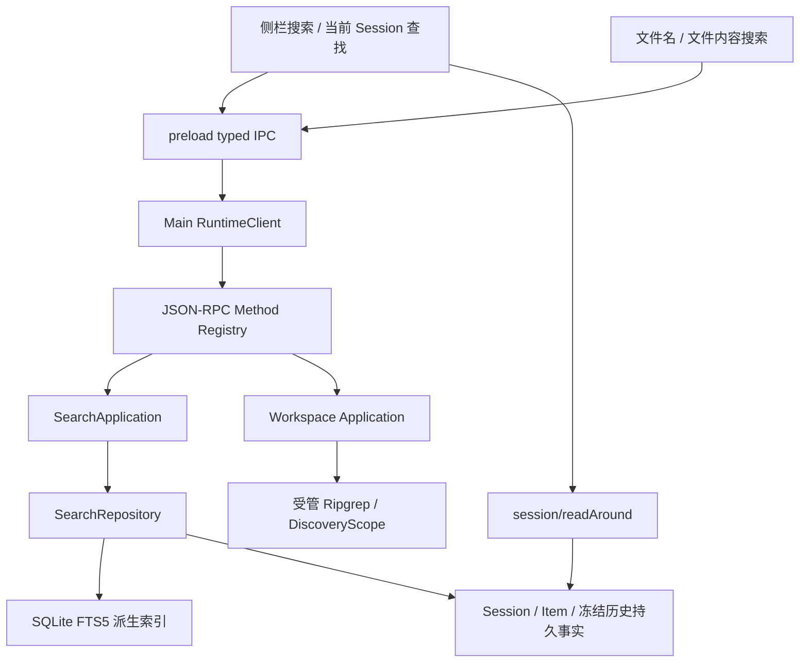

# Eidos 搜索调研与实施方案

调研日期：2026-10-20。本文是待实施方案，不表示搜索能力已经上线。

## 1. 结论与范围

Eidos 应先提供五项基础能力：跨 Session 搜索、当前 Session 全文查找、按文件名查找、跨文件内容搜索、当前文件内查找。侧栏可以承载统一入口，但每个入口必须说明自己的搜索范围。

第一期的侧栏“搜索”应覆盖所有已保存的普通 Session，包括所有 Project、Projectless、Local 和 Worktree。系统应搜索标题和消息正文，并把结果定位到具体消息。项目名称可以作为另一组导航结果。系统不应在输入关键词时遍历所有项目的磁盘文件。

全文搜索必须覆盖尚未加载到 Renderer 的历史。系统不能把“当前列表没有匹配项”写成“没有搜索结果”。

## 2. ChatGPT 的已确认行为

### 2.1 桌面端需要区分版本与视图

OpenAI 已把旧 macOS 应用称为 ChatGPT Classic。新版桌面应用包含 Chat、Work 和 Codex。Chat/Work 与 Codex 的历史仍有边界。用户不能把一个入口理解为搜索所有视图、所有设备和所有连接服务。

来源：[新版桌面应用迁移说明](https://help.openai.com/en/articles/20001276-moving-to-the-new-chatgpt-desktop-app)。

| 入口 | 官方明确的范围或行为 | 尚未确认的部分 |
| --- | --- | --- |
| 新版桌面侧栏 Search chats | 用户可以找回过去的聊天；启用扩展匹配时，搜索也能匹配正文和 Git 分支名 | 官方没有完整列出工具输出、附件正文、归档聊天及跨视图的统一覆盖规则 |
| 当前聊天 Find in chat | 用户用 `⌘F` 查找当前聊天，用 `⌘G` / `⌘⇧G` 切换命中 | 官方没有解释分页、折叠内容和索引结构 |
| Projects 视图搜索 | 用户可以从 Projects 视图搜索项目 | 官方没有在该页定义项目文件正文是否属于这个入口 |
| Codex Search files | 桌面快捷键是 `⌘P` | 该命令页没有说明它是否覆盖文件正文，不能仅凭名称认定它是跨文件全文搜索 |
| ChatGPT 通用侧栏搜索 | 官方帮助页列出聊天、项目、图片、文档，以及具备权限的部分连接文件；聊天可以按标题和消息匹配，归档聊天仍可搜索，删除聊天被排除 | 该页明确列举 web、iOS、Android；结果类型和筛选会随账户、工作区和设备变化，不能全部视为桌面端承诺 |
| Library 搜索 | 用户可以查找已上传、已生成及可用的连接文件，并按来源和文件类型筛选 | 官方没有承诺该文件搜索会对每种格式的全部正文做相同匹配 |
| Web search | 模型查询互联网，并在聊天中留下搜索活动 | 这个范围与用户的聊天历史、磁盘文件不同 |

来源：[桌面命令与快捷键](https://learn.chatgpt.com/docs/reference/commands)、[Projects and chats](https://learn.chatgpt.com/docs/projects)、[通用侧栏搜索](https://help.openai.com/en/articles/10056348-finding-your-chats-projects-and-files-in-chatgpt)、[Library](https://help.openai.com/en/articles/20001052-using-library-to-manage-files-in-chatgpt)、[Web search](https://learn.chatgpt.com/docs/web-search)。

新版桌面 `⌘K` 打开命令菜单；Search chats 默认没有快捷键。网页版帮助页中的 `⌘K` 搜索规则不能直接当成新版桌面的规则。Classic 的发布记录则明确记录了历史会话搜索，以及当前会话的 `⌘F` 查找。

来源：[桌面命令](https://learn.chatgpt.com/docs/reference/commands)、[Classic 发布记录](https://help.openai.com/en/articles/9703738-chatgpt-macos-app-release-notes)。

### 2.2 实现事实的边界

上述来源说明了产品行为。公开资料没有说明 ChatGPT 历史搜索使用哪个数据库、倒排索引、分词器或排序公式，也没有证明它依赖向量或模型。本文下面的 SQLite、Ripgrep 和接口设计均是 Eidos 的建议。

本次工具禁止读取 `com.openai.codex` 的桌面窗口，所以本次没有完成 ChatGPT 实机搜索验证。本文也没有把旧版帮助页曾描述的精确匹配、Canvas 排除规则写成新版桌面的完整规则。

## 3. Eidos 当前源码与缺口

| 范围 | 当前事实 | 方案中的位置 |
| --- | --- | --- |
| 侧栏 | `SessionSidebar` 分组显示项目、Session 和置顶项，没有聊天全文搜索入口 | P0 |
| Session 正文 | `session/read` 分页；`useSessionController` 向前读取历史；现有来源定位最多累积 20,000 条 Item | P0；需要完整搜索和按消息读取附近记录 |
| 文件树与预览 | `WorkspaceExplorer` 使用 `workspace/listDirectory` 和 `workspace/readFilePreview`；组件已有行列定位 | P0；复用预览与定位能力 |
| Agent 文件内容搜索 | `RipgrepSearchDriver` 已支持字面量、正则、路径、include glob、取消和有界结果 | P0；复用 Driver 与安全范围，补用户界面 API |
| 代码索引 | `repository_fts` 搜索代码索引记录，不是聊天历史索引 | 复用 SQLite 能力，不混用语料 |
| 记忆搜索 | Memory 页面已有搜索；Repository 使用 word FTS 和可选 trigram，并对部分短词做有界处理 | 保留独立授权与撤销语义，不直接当聊天搜索实现 |
| 项目、Skill、Agent | 这些选择器或设置页已有局部搜索 | 保留；后续可从统一入口跳转 |
| 定时任务 | `AutomationTaskList` 按已加载条目的任务名称筛选；页面会提示还有未加载数据 | P2；未来需要服务端完整搜索 |
| 终端 | `TerminalPanel` 当前只加载 FitAddon；保留 5,000 行 scrollback，没有 SearchAddon | P2；只查当前缓冲区 |
| PDF | `PdfViewer` 主要使用 Canvas 绘制页面，没有接入全文查找控制器 | P2；需要文本层和现有 PDF.js 查找能力 |

主要证据：

- [`SessionSidebar.tsx`](../desktop/renderer/src/components/SessionSidebar.tsx)、[`useSessionController.ts`](../desktop/renderer/src/app/useSessionController.ts)、[`SessionRepository`](../runtime/eidos_runtime/db/repositories/sessions.py)
- [`WorkspaceExplorer.tsx`](../desktop/renderer/src/components/WorkspaceExplorer.tsx)、[`WorkspaceExplorerApplication`](../runtime/eidos_runtime/application/workspace.py)、[`search_driver.py`](../runtime/eidos_runtime/workspace/search_driver.py)
- [`schema.py`](../runtime/eidos_runtime/db/schema.py)、[`SessionHistoryRepository`](../runtime/eidos_runtime/persistence/session_history.py)、[`MemoryRepository`](../runtime/eidos_runtime/memory/repository.py)
- [`AutomationTaskList.tsx`](../desktop/renderer/src/components/automations/AutomationTaskList.tsx)、[`TerminalPanel.tsx`](../desktop/renderer/src/components/TerminalPanel.tsx)、[`PdfViewer.tsx`](../desktop/renderer/src/components/PdfViewer.tsx)

当前 `items.content` 保存消息正文。分叉的冻结历史另有 `session_history_entries` 和 Blob；系统不能只查询 `items`。当前 Schema 版本是 31，实施时需要重新确认版本，并在最新版本上增加迁移。

## 4. 产品范围与交互

| 能力 | 默认搜索范围 | 用户看到的结果 | 优先级 |
| --- | --- | --- | --- |
| 侧栏全局搜索 | 当前 Eidos 数据目录下，所有普通 Session 的标题、用户消息和助手消息；项目名称另组显示 | 系统每个 Session 显示一行，带项目、标题、时间和命中片段；用户展开后查看同一 Session 的更多命中 | P0 |
| 当前 Session 查找 | 当前 Session 的全部持久消息，包括冻结的继承历史 | 系统显示命中片段、上一处和下一处，并跳转消息 | P0 |
| 按文件名查找 | 当前 Session 的实际 execution root 下，可发现文件的相对路径与名称 | 用户选择后打开文件，并展开对应目录 | P0 |
| 跨文件内容搜索 | 同一 execution root 下的可搜索文本文件 | 系统按文件分组，显示路径、行号、列号和片段 | P1 |
| 当前文件查找 | 当前文件的可读取全文；系统明确提示文件截断或格式限制 | 系统在文件内高亮并跳转 | P1 |
| 执行详情搜索 | 用户主动启用后，当前 Session 的工具名、命令和可展示的持久输出 | 系统定位并展开对应执行卡；大输出按页读取 | P2 |
| Diff 查找 | 当前选中的“未提交 / 最近一轮 / 整个任务”范围 | 系统在文件路径与补丁行中定位，并保留范围标签 | P2 |
| 终端、网页、PDF 查找 | 当前终端缓冲区、当前网页、当前 PDF | 系统分别显示该面板内的命中 | P2 |
| 设置与资源查找 | 设置项名称、Skill、Agent、MCP、Plugin、定时任务元数据 | 用户直接跳转对应页面 | P2 |
| 附件与产物检索 | Eidos 已记录且仍有效的附件、产物名称与路径 | 系统显示来源 Session，并重新验证文件是否可用 | P2 |

侧栏第一期不搜索任意文件正文、工具参数 JSON、内部诊断、模型回放、ContextSnapshot 或长期记忆。用户以后可以显式切换资源类型。长期记忆继续通过原有 Memory 服务检查范围、遗忘和撤销。

Project 过滤属于同一全局搜索能力。用户从项目菜单选择“搜索此项目”后，系统应预选该项目。Projectless 需要单独的“无项目”过滤，不能用空字符串代替所有项目。

内部子 Agent Session 默认不单独进入全局列表。后续的“包含子任务”选项可以把命中挂在父任务下，再进入 Agent 详情。分叉保留独立 Session 结果，并显示继承来源，系统不应擅自丢掉重复前缀。

### 4.1 搜索入口

- 侧栏在“新建会话”附近增加“搜索”。用户打开后看到搜索弹层、范围选择和结果。空输入展示最近访问的 Session；系统不读取正文填满空结果。
- Eidos 可以把 `⌘K` 分配给全局搜索。这是 Eidos 的产品选择。如果未来增加命令菜单，命令菜单使用 `⌘⇧P`。终端聚焦时，系统保留终端自己的按键行为。
- 用户使用 `⌘P` 按名称找文件，使用 `⌘⇧F` 搜索当前工作区的文件内容。界面始终显示当前目录或 Worktree。
- 用户使用 `⌘F` 搜索当前聚焦面板；聊天区、文件预览、Diff、终端和网页各自声明自己的查找范围。焦点不在可查找面板时，系统默认搜索当前聊天。
- 用户使用 Enter / Shift+Enter 或 `⌘G` / `⌘⇧G` 切换命中，使用 Escape 关闭。系统关闭弹层后恢复原焦点，保留结果页的查询与滚动位置。

### 4.2 侧栏结果示例

```text
搜索  [SQLite                     ]  [所有项目 ▾]

会话
  修复历史读取问题          Eidos · 10月18日
  ……共享 SQLite 连接需要在 owner lock 内读取结果……
  标题命中 / 正文命中 · 查看此会话的更多结果

项目
  Eidos
```

该示例只说明结果结构，系统不能把示例当成已有搜索结果。

## 5. 侧栏全局搜索的实现

### 5.1 最小调用链



Runtime 保留范围、可见性、分叉历史和排序规则。SQLite FTS5 负责索引与候选检索。Main 只转发与校验。Renderer 只保存当前查询、结果投影、焦点与滚动位置。

搜索不创建 Run，也不调用模型或 Agent 的 `search_text` Tool。文件搜索只复用该 Tool 底层的 Driver、发现范围和身份核验。

### 5.2 索引结构

建议在原 SQLite 中增加以下派生结构。最终 SQL 需要随 Schema 迁移和恢复测试一起审查。

| 结构 | 必要字段与作用 |
| --- | --- |
| `search_documents` | 系统保存 `id`、`kind`、`session_id`、可空的 `item_id`、`run_id`、`project_id`、来源类型、稳定排序位置、来源修订、标题与可搜索文本。`kind` 第一阶段只允许 `session_title`、`message`、`project` |
| `search_fts` | FTS5 trigram 索引搜索文本；系统通过 document ID 回到来源映射 |
| `search_index_state` | 系统保存投影版本、回填游标、索引状态和已处理的来源位置；这些字段只描述可重建的索引进度 |

消息文档以显示 Session 与显示 Item 为身份。继承消息使用冻结历史中的 Item ID，并记录继承来源。系统不从原 Session 的可变内容重新构造已冻结的分叉。

索引不是第二套业务事实。系统删除索引后应能从持久来源完整重建。查询返回片段前必须检查来源仍然存在且仍可展示。删除来源后的旧索引不能泄漏片段。来源 Session 删除后，仍被合法分叉持有的冻结副本按现有分叉语义继续存在。

### 5.3 文本与中文匹配

第一期采用大小写不敏感的字面量子串匹配。标点、下划线和代码标识符按原样处理。系统不开放正则、FTS 查询语法或语义改写；输入中的引号、`OR`、星号均为普通文字。

系统应使用成熟 Markdown Parser 生成搜索文本，保留段落、表格文字、链接显示文字、行内代码和代码块。系统不索引隐藏链接目的地或图片二进制。数学公式先按持久的 LaTeX 文字搜索。搜索文本与 Renderer 的文字映射必须有共享样本，避免“搜索命中但页面没有对应文字”。

候选方案为 `markdown-it-py`。当前锁文件已有该包，但 `pyproject.toml` 没有将其列为显式生产依赖。实施者如采用它，必须补充直接依赖、锁文件、许可与审计检查，并验证 Runtime Bundle。实施者不能用正则自行删除 Markdown 语法。解析器能力见 [markdown-it-py 官方文档](https://markdown-it-py.readthedocs.io/en/latest/)。

SQLite trigram 支持一般子串，但少于三个 Unicode 字符的全文查询没有匹配结果。系统不能把 FTS 的这个限制变成中文两字词“没有结果”。来源：[SQLite FTS5](https://sqlite.org/fts5.html#the_trigram_tokenizer)。

- 对至少三个字符的查询，系统通过 trigram 取得候选，再按统一的字面量规则核验。
- 对一到两个字符的查询，系统先查名称，再按稳定位置分批扫描正文投影。系统返回继续游标和“仍在搜索”状态。用户缩小到项目或 Session 后，系统减少扫描范围。
- 系统固定 Unicode 规范化与大小写规则，并保证候选召回不会漏掉核验器接受的结果。系统对大小写折叠前后长度变化保存偏移映射；最终高亮以原文为准。
- 系统达到时间、行数或字节预算时返回未完成状态，不能声称零结果或给出完整命中总数。系统不长期持有数据库锁扫描历史。
- 系统在 packaged Runtime 中核对 FTS5 与 trigram。能力缺失时，系统可以提供明确标记的有界扫描，但不能静默降级成仅查最近记录。

### 5.4 更新、回填与排序

系统在消息正文持久提交、标题修改和分叉历史建立时登记索引更新。系统在终态消息提交后更新正文索引，不按每个流式 token 重建 FTS。失败、取消 Run 中已保存且可见的消息同样进入搜索。

当前 Session 可以对正在显示的流式文字补充临时查找，并标记“生成中”。该结果只属于当前界面的文字缓存。系统在正文持久提交后按 Item ID 与修订去重，不能把临时缓存作为全局历史索引来源。搜索尚未完成时，计数应显示“已找到 12 处”，不能把它写成完整总数。

系统对新增、删除和修订使用原有事务与 Event/Outbox。需要异步解析的消息先在来源事务中登记可幂等重试的投影工作；索引提交再次核对来源修订。已删除来源不能被迟到回填重新建立索引。系统通过现有异步内核管理投影资源，不新增独立守护进程或每次输入一个线程。

旧历史按消息与字节预算分批回填。系统只在短事务内读取有界数据，随后在锁外解析。界面在回填期间显示“历史记录正在建立索引”。用户仍可搜索已经完成的部分，但系统必须标记范围尚未完整。

排序第一期采用可解释规则：完整标题命中、标题前缀命中、标题其他命中、正文命中；同一层按最近活动时间和稳定 ID 排序。项目结果单独成组。系统按 Session 去重分页，不能先对消息 `LIMIT 30` 再去重，否则结果可能只有一个 Session。

游标绑定查询、过滤、排序与索引代次。代次变化时，系统明确刷新结果并保留当前选择，不能用改变后的排序继续旧游标。第一期不要求全量精确计数。当前 Session 的结果按消息顺序及消息内偏移排列。

## 6. 协议与命中定位

以下名称是待实施接口。现有 `session/list` 和 `session/read` 保持兼容。

| 方法 | 请求的关键字段 | 响应的关键字段 |
| --- | --- | --- |
| `search/sessions` | `query`、`scope: all / project / projectless`、`projectId`（按 scope 校验）、`cursor`、`limit` | Session 结果、独立项目结果、命中类型、首个消息锚点、纯文本片段、高亮区间、`nextCursor`、`indexStatus`、`complete` |
| `session/search` | `sessionId`、`query`、`cursor`、`limit` | 消息 ID、继承来源、文字区间、前后顺序游标、搜索完成状态 |
| `session/readAround` | `sessionId`、`itemId`、前后条数 | 包含目标 Item 的有界历史窗口、该窗口所需 Run、前后游标 |
| `workspace/searchFiles` | `sessionId`、`query`、相对子目录、`limit` | 相对路径、是否截断、实际 execution root 的版本标识 |
| `workspace/searchText` | `sessionId`、`query`、相对路径、include/exclude glob、大小写与正则选项、结果上限 | 文件分组、行列、片段、截断原因和查询状态 |

DTO 必须使用现有严格 Pydantic 基类和判别联合，TypeScript 从单一 Schema 生成。实现者还需补齐 Registry、Main、preload、共享 Fixture 和两端定向测试。建议新增 `protocol/search.py`、`application/search.py`、`persistence/search.py`；实现者不应为这个功能搬迁旧目录。

每页建议默认 30 个 Session，上限 100；片段建议最多 240 个字符，每行最多两个片段；响应还需要独立的总字节预算。查询建议最多 256 个 Unicode 字符。实施者应根据规模测量调整这些初始值。

系统使用 `sessionId + itemId + sourceRevision + matchRange` 表达聊天位置。字符区间使用 Unicode code point，并由客户端明确转换为 JavaScript UTF-16 偏移。Renderer 用原始文字与安全节点高亮，不能把数据库生成的 HTML 插入页面。

`session/readAround` 必须直接支持普通与继承 Item。它应只读取聊天持久事实，不激活执行环境，不要求旧 Worktree 仍在磁盘上。用户从搜索进入消息时，系统不应从最新记录逐页累积到 20,000 条后才尝试定位。

聊天内容在当前高亮范围外被折叠时，系统只展开包含命中的展示块。窗口切换、Session 切换和新关键词必须使旧响应失效。用户只关闭搜索框时，系统不应跳回聊天底部。

## 7. 工作区与面板内查找

工作区搜索使用当前 Session 的实际 execution root。Local 与 Worktree 必须分别绑定，系统不能把 Project 根路径当作所有会话的执行目录。Projectless 的权限仍只覆盖其私有 Workspace；是否展示其 Files 面板属于后续产品选择，不应随搜索功能隐式改变。

文件名搜索应使用完整的有界发现结果与现有 RapidFuzz 排序，不能只过滤当前已展开的树节点。内容搜索复用受管 Ripgrep。当前 Driver 固定忽略大小写，单文件大小上限为 256 KiB；如果界面提供大小写开关、exclude glob 或更大的文件上限，实现者必须先扩展请求契约和定向测试，不能只增加 UI 控件。

系统默认沿用 `.gitignore`、`.eidosignore` 与当前 hard discovery 范围。界面可以说明“包含被忽略文件”的具体含义，但该选项不能解除权限边界。系统依旧核验根目录身份、路径与符号链接，并在打开命中时核对文件版本。

现有 Driver 返回的列来自 Ripgrep 的输出；接入界面前必须明确字节列与 Unicode 字符列的转换，并覆盖中文、Emoji 与组合字符。系统不能直接把该值当成 Renderer 的字符列。

长查询可以返回受管的查询句柄，再通过补充的 wait/cancel 方法读取状态。句柄归当前窗口和 execution root 所有；用户切换查询或关闭页面时取消资源。进程、输出和超时保持有界。该查询容量不能变成跨 Session 的 Run 配额。

对于超出预览窗口的命中，系统需要版本绑定的文件片段读取，或明确提示预览范围不足。系统不能跳到相同行号的另一文件版本，也不能把预览截断误报为全文无命中。

Electron 的 `webContents.findInPage` 可以用于独立网页面板内查找，但它搜索该网页，不能替代跨数据库历史搜索。主窗口还包含侧栏和其他面板，因此聊天正文需要按数据范围查找。来源：[Electron 官方 API](https://www.electronjs.org/docs/latest/api/web-contents#contentsfindinpagetext-options)。

终端后续使用成熟的 [Xterm SearchAddon](https://raw.githubusercontent.com/xtermjs/xterm.js/master/addons/addon-search/README.md)，范围仅为当前缓冲区。PDF 后续复用 [PDF.js 的查找控制器与 Viewer](https://github.com/mozilla/pdf.js/blob/master/examples/components/simpleviewer.mjs)，并补文本层。系统不应对扫描 PDF 承诺 OCR 搜索。

## 8. 实施顺序与验收

### 阶段一：侧栏与 Session 搜索闭环

实现者完成索引迁移、旧历史回填、`search/sessions`、`session/search`、`session/readAround`、侧栏弹层与正文高亮。实现者同时完成项目过滤、Projectless、冻结分叉历史和结果分页。

验收要求：

- 用户可以找到第 51 个之后的 Session，以及尚未加载的早期消息。
- 用户可以用中文一字、两字和长词、英文、路径、代码标识符、标点和 Emoji 搜索。系统对不完整扫描显示明确状态。
- 用户可以从搜索直接打开数万条历史之前的命中。旧 Worktree 不存在时，聊天历史仍然可读。
- 系统不会把内部子任务、工具输出或记忆正文默默混进普通结果。
- 系统重启、回填中断、消息修订与删除、分叉来源删除、SQLite Busy、投影重复处理均有定向覆盖。
- 系统在快速输入、中文输入法组合、切换 Session 和关闭弹层时不会接受迟到结果，也不会丢失草稿与阅读位置。

### 阶段二：工作区文件搜索闭环

实现者完成按名称找文件、跨文件文本搜索、当前文本/代码/Markdown 文件查找，以及版本绑定的跳转。实现者复用现有 Driver、DiscoveryScope 与预览能力。

验收要求：用户可以找到未展开目录中的文件；Local、Worktree、重命名、删除、文件替换、中文列位置、取消、大仓截断和预览窗口外的命中均得到明确处理。真实路径与 Seatbelt 边界发生变化时，实现者补真实原生验证。

### 阶段三：执行详情与其他面板

实现者按使用频率补工具输出、Diff、终端、网页和 PDF 查找，再补附件/产物与设置资源的导航搜索。每种类型必须先固定可搜索正文、定位和删除规则，再进入统一结果页。系统暂不需要跨所有本地项目的磁盘全文索引或向量数据库。

三个阶段围绕同一目标时，可以使用同一分支和一个 PR，并按索引、协议、聊天界面、工作区能力分别提交。每个提交应有可独立审查的边界。实施者不应混入目录重组或通用异步迁移。

### 性能目标与验证范围

建议使用合成数据建立 10,000 个 Session、100,000 条消息的基准，并记录文本总量、最长消息和目标 Mac 配置。以下数字是待验证目标：已建立索引的常用查询首屏 P95 小于 300 ms；消息定位 P95 小于 500 ms；新输入不被旧查询阻塞。短词扫描单独报告首个结果耗时和完整扫描耗时，不能套用索引查询目标。

实现者先运行对应 Runtime、协议、Renderer/Main 的定向检查，再用真实 Electron 检查焦点、输入法、快捷键、滚动和多面板范围。新增依赖时，实现者补 Ruff、Deptry、pip-audit 和打包边界验证。实现者需要增加真实旧 Schema 升级、迁移失败回滚、索引重建和重启恢复样本。

本次只新增方案文档。本次没有修改生产代码、协议、Schema、依赖或现有测试，也没有运行测试、Full Suite、构建或 Electron 验收。
